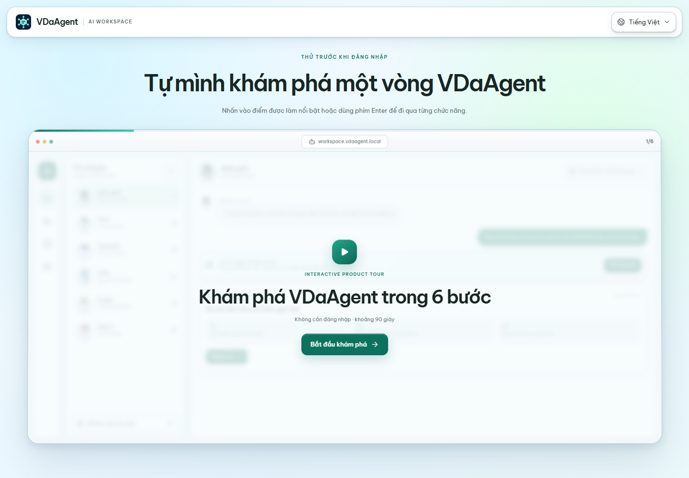
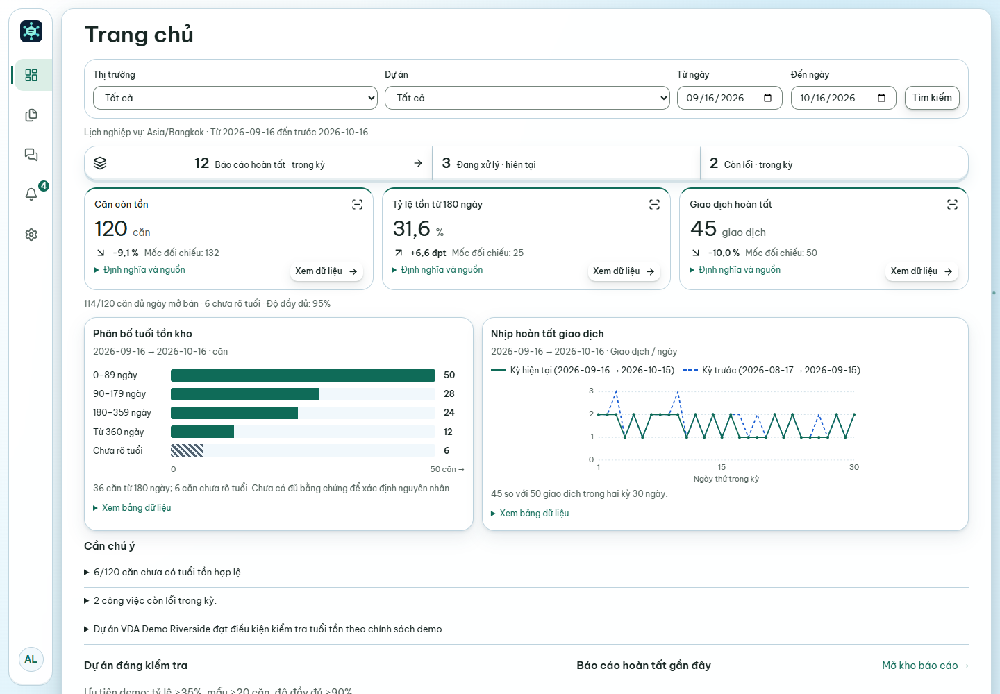
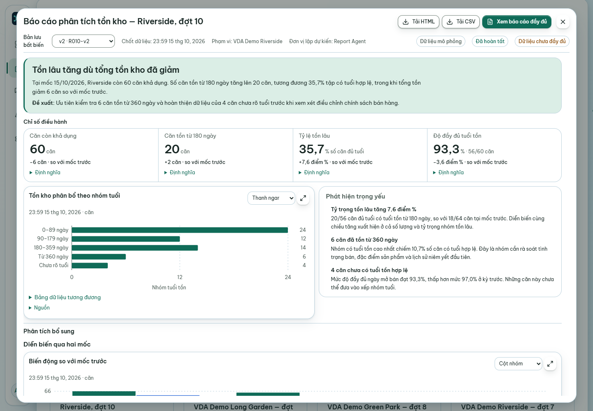
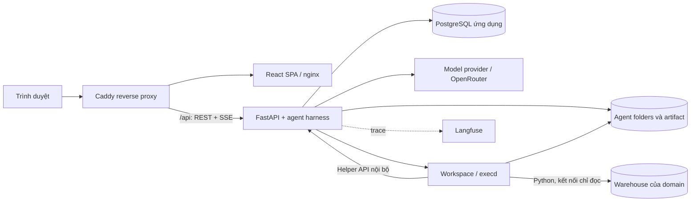

# VDaAgent

**Không gian làm việc với một đội AI agent riêng: hỏi bằng tiếng Việt, phân tích dữ liệu doanh nghiệp và đọc kết quả dưới dạng báo cáo có nguồn.**

[](https://github.com/mhiu05/VDaAgent/actions/workflows/ci-cd.yml)

VDaAgent là một dự án PoC cho quy trình phân tích dữ liệu có nhiều agent phối hợp. Mỗi người dùng được gán một **domain** — miền nghiệp vụ gồm hướng dẫn, kỹ năng, cấu hình truy cập dữ liệu và các agent khởi tạo sẵn. Agent điều phối tiếp nhận yêu cầu, giao việc cho agent chuyên môn và trả kết quả vào cuộc trò chuyện. Agent có thể chạy Python, truy vấn warehouse, tạo biểu đồ và xuất bản báo cáo.

Domain mẫu trong repository là **Fabrikam Sales Ops**, phục vụ phân tích tồn kho và giao dịch bất động sản. Hạ tầng domain cho phép bổ sung miền nghiệp vụ khác; dữ liệu, truy vấn và hướng dẫn chuyên ngành vẫn cần được cấu hình cho từng domain.



*Ảnh chụp giao diện thật từ frontend chạy ở chế độ mock. Tên dự án, số liệu và nội dung trong các ảnh bên dưới là dữ liệu minh họa, không phải kết quả phân tích warehouse thật.*

## Mục lục

- [Sản phẩm giải quyết việc gì?](#san-pham)
- [Giao diện sản phẩm](#giao-dien)
- [Khái niệm và đội agent](#khai-niem)
- [Kiến trúc và luồng xử lý](#kien-truc)
- [Chọn cách chạy](#cach-chay)
- [Cài đặt stack đầy đủ](#cai-dat)
- [Cấu hình](#cau-hinh)
- [Quản lý domain và dữ liệu](#domain)
- [Hướng dẫn sử dụng](#su-dung)
- [Vận hành và dữ liệu lưu trữ](#van-hanh)
- [Phát triển và kiểm thử](#phat-trien)
- [API và tích hợp](#api)
- [CI/CD và triển khai](#trien-khai)
- [Xử lý sự cố](#su-co)
- [Giới hạn và tài liệu tham chiếu](#tai-lieu)

<a id="san-pham"></a>

## Sản phẩm giải quyết việc gì?

VDaAgent hướng tới người làm phân tích, Sales Ops và quản lý cần tìm hiểu dữ liệu bằng hội thoại, đồng thời giữ được báo cáo để xem lại. Ví dụ yêu cầu khi domain và warehouse đã được kết nối:

> Phân tích tồn kho của dự án này, chỉ ra các nhóm căn cần kiểm tra và lập báo cáo kèm biểu đồ. Ghi rõ nguồn dữ liệu và những giới hạn của kết luận.

| Nhu cầu | Cách VDaAgent hỗ trợ |
|---|---|
| Đặt câu hỏi bằng ngôn ngữ tự nhiên | Chat với agent điều phối hoặc từng agent chuyên môn; theo dõi tiến trình qua sự kiện trực tiếp. |
| Phân tích dữ liệu doanh nghiệp | Agent chạy Python trong workspace riêng, dùng credential set được cấp theo domain. |
| Chia công việc theo chuyên môn | Điều phối, dữ liệu, so sánh, insight, biểu đồ và báo cáo có vai trò riêng. |
| Giữ kết quả để đọc lại | Kho báo cáo có phiên bản, nội dung có cấu trúc, bằng chứng và tệp đính kèm khi được xuất bản. |
| Theo dõi tình hình tổng quan | Dashboard đọc dataset đã công bố: tồn kho, tuổi tồn, giao dịch, tác vụ và báo cáo. |
| Cộng tác | Nhóm chat có thành viên người dùng và đội agent riêng của nhóm. |
| Tùy biến agent | Tạo agent, chỉnh prompt, quản lý skill, package, lịch chạy và credential set trong phạm vi cho phép. |
| Quản trị | Quản lý người dùng, domain, starter agent, trạng thái khởi tạo và kiểm tra hoạt động agent. |

Kết quả thực tế phụ thuộc model, chất lượng dữ liệu và cấu hình domain. Dashboard không tự truy vấn warehouse từ trình duyệt; nó hiển thị dataset đã được agent hoặc lệnh đồng bộ xuất bản.

<a id="giao-dien"></a>

## Giao diện sản phẩm

### Dashboard



*Dashboard mock thể hiện bộ lọc theo thị trường, dự án, khoảng ngày, chất lượng nguồn và các mục cần chú ý. Khoảng ngày trong ảnh thuộc bộ fixture demo.*

### Kho báo cáo và trình đọc



*Báo cáo mock minh họa cách đọc kết luận, chỉ số, biểu đồ và bằng chứng trong một phiên bản đã lưu. Thay bộ lọc dashboard không viết lại nội dung phiên bản báo cáo.*

<a id="khai-niem"></a>

## Khái niệm và đội agent

| Khái niệm | Ý nghĩa trong dự án |
|---|---|
| Domain | Miền nghiệp vụ được admin cấu hình: hướng dẫn, skill, credential set và starter agent. |
| Lead | Agent điều phối mặc định của mỗi đội; không thể xóa như agent thông thường. |
| Starter | Mẫu agent được tạo khi khởi tạo đội của người dùng hoặc nhóm. |
| Thread | Luồng hội thoại với agent hoặc trong nhóm. |
| Task | Công việc có trạng thái chờ, chạy, hoàn tất, lỗi hoặc hủy; khác với một tin nhắn đơn lẻ. |
| Workspace | Thư mục agent, gồm prompt, môi trường Python, skill, file kết quả và lịch sử Git. |
| Credential set | Bộ khóa cấu hình có tên, ví dụ `warehouse`, được gắn cho agent cần dùng. |
| Dataset | Dữ liệu có cấu trúc đã công bố cho dashboard; khác với tài liệu báo cáo. |
| Report version | Bản nội dung báo cáo đã lưu, gắn với bằng chứng và artifact của phiên bản đó. |

Đội mẫu của Fabrikam gồm lead và năm agent chuyên môn:

| Agent | Vai trò |
|---|---|
| `lead` | Điều phối yêu cầu và phối hợp các agent. |
| `data` | Khám phá nguồn, truy vấn và chuẩn bị dữ liệu. |
| `compare` | So sánh các nhóm, dự án hoặc khoảng thời gian phù hợp. |
| `insight` | Tổng hợp phát hiện và diễn giải trong phạm vi bằng chứng. |
| `chart` | Tạo biểu đồ phục vụ câu hỏi phân tích. |
| `report` | Tổng hợp và xuất bản báo cáo. |

Tên và vai trò starter có thể thay đổi theo domain. Giới hạn mặc định là 12 agent mỗi người dùng. Nhóm chat dùng tài khoản dịch vụ và workspace riêng cho đội của nhóm; không sử dụng trực tiếp thư mục agent cá nhân của một thành viên.

<a id="kien-truc"></a>

## Kiến trúc và luồng xử lý



| Thành phần | Công nghệ và nhiệm vụ |
|---|---|
| Frontend | React 19, TypeScript, Vite 8, Tailwind CSS 4; giao diện tiếng Việt/Anh, adapter mock/API. |
| Backend | Python 3.12, FastAPI, Pydantic, SQLAlchemy async, Alembic; auth, dữ liệu ứng dụng, job worker và agent harness. |
| Runtime agent | `execd`, môi trường Python theo agent, uv, Git, thư viện helper `contoso`. |
| Lưu trữ | PostgreSQL 17 cho người dùng, session, hội thoại, task, domain, dataset và metadata báo cáo; volume cho file. |
| Model | Agent và compaction qua chat completions có tool calling; lead routing dùng Jev và Decisions API. |
| Quan sát | Log container và Langfuse cho trace của các lượt model/agent. |
| Đóng gói | Docker Compose, nginx phục vụ SPA, Caddy gom UI và API vào cùng origin. |

Một yêu cầu được xử lý như sau:

1. Backend xác thực session, quyền sở hữu và trạng thái domain/đội khi nhận tin nhắn.
2. Lead phân loại yêu cầu để định tuyến. Công việc được xếp hàng; harness giới hạn một task đang chạy cho mỗi chủ sở hữu đội.
3. Agent đọc ngữ cảnh, gọi model và thực hiện tool. Python chạy qua `execd` trong workspace tương ứng, có giới hạn thời gian và bộ nhớ.
4. Agent có thể giao việc cho agent khác, tạo file, công bố dataset hoặc báo cáo. Tool output và trace nội bộ được tách khỏi thông điệp gửi cho người dùng.
5. Backend lưu trạng thái và đẩy sự kiện SSE cho frontend. Người dùng xem tiến trình, kết quả và phiên bản báo cáo.
6. Runtime nén ngữ cảnh tại các điểm an toàn giữa task khi cần; output dài có thể được đưa ra khỏi context model và lưu thành file trong workspace.

Tên `contoso` vẫn được dùng cho namespace Python, database, Compose project và một số tên image/volume nội bộ. Đây là định danh kỹ thuật đang được code sử dụng; tên sản phẩm là **VDaAgent**.

<a id="cach-chay"></a>

## Chọn cách chạy

| Cách chạy | Cần gì? | Mục đích |
|---|---|---|
| **Frontend mock** | Node.js 24+, npm 11 | Xem UI, báo cáo và hội thoại mô phỏng; không cần Docker, API key hoặc warehouse. |
| **Stack + FakeModel** | Docker Compose, cấu hình admin và secret nội bộ | Kiểm tra API, auth, DB, runtime và kịch bản agent xác định; không gọi model thật. |
| **Stack + model thật** | Như trên, thêm model API key và credential domain | Phân tích dữ liệu được kết nối. |

### Xem sản phẩm bằng frontend mock

```bash
git clone https://github.com/mhiu05/VDaAgent.git
cd VDaAgent/frontend
npm ci
npm run dev -- --port 5173 --strictPort
```

Mở <http://127.0.0.1:5173>. Chọn **Bắt đầu khám phá**, đi hết hoặc bỏ qua tour, rồi chọn **Create your own agent** để mở đăng nhập. Chọn **Demo Alice** để vào không gian mẫu hoặc **Demo quản trị** để xem quản trị mock.

Cũng có thể đăng nhập mock bằng `user@vdaagent.test` / `DemoUser!2026`. Đây chỉ là tài khoản fixture frontend, không phải tài khoản backend. Các profile người dùng mock cùng sử dụng bộ dữ liệu mẫu.

Khi không đặt `VITE_SERVICE_MODE`, Vite local dùng `mock`. Nếu máy đã đặt biến này thành `hybrid` hoặc `api`, đổi lại `mock` trước khi chạy. Mock không ghi vào PostgreSQL và chat không gọi model thật. Một số tùy chọn demo được giữ trong browser storage.

### Chạy stack với FakeModel

Thực hiện bước chuẩn bị ở phần tiếp theo, điền admin và đặt trong `.env`:

```dotenv
MODEL_BACKEND=fake
VITE_SERVICE_MODE=hybrid
```

Không cần `OPENROUTER_API_KEY` trong chế độ này. Để khởi động dịch vụ mà chưa chạy chuỗi bootstrap demo:

```bash
docker compose --profile proxy up -d --build --wait
```

Đăng nhập bằng admin đã cấu hình để quản lý domain/người dùng. FakeModel trả lời theo kịch bản xác định trong code test; không hiểu câu hỏi tự do và không giả lập warehouse. Muốn dùng domain mẫu và bootstrap đầy đủ vẫn cần điền các credential domain yêu cầu. Bộ E2E có stack fixture riêng cho kiểm thử tự động.

<a id="cai-dat"></a>

## Cài đặt stack đầy đủ

### Yêu cầu

- Docker Engine hoặc Docker Desktop, Buildx và Compose v2 bản mới, hỗ trợ `include`, `!override`, `!reset`, `up --wait`.
- Git, GNU Make và shell Linux cho các lệnh `make` bên dưới. Trên Windows, nên dùng WSL 2 với Docker Desktop WSL integration.
- Dự trù khoảng 6 GB RAM và 10 GB ổ đĩa trở lên cho Docker; Langfuse/ClickHouse, image và cache package chiếm thêm tài nguyên theo thời gian.
- Mạng để tải image/package; model API key khi dùng model thật; warehouse và credential domain khi phân tích dữ liệu thật.

Chạy stack Docker không yêu cầu cài Python, Node hay uv trên host. Chạy frontend ngoài container mới cần Node/npm trên host.

### Linux / macOS / WSL 2

```bash
git clone https://github.com/mhiu05/VDaAgent.git
cd VDaAgent
make setup
# Điền ADMIN_USERNAME, ADMIN_PASSWORD, OPENROUTER_API_KEY trong .env.
# Điền domains/<id>/credentials/*.env theo domain cần sử dụng.
make check
make up
make health
```

`make setup` tạo `.env`, sinh secret nội bộ và tạo file credential từ template; không ghi đè giá trị đã có. `make check` báo tên cấu hình còn thiếu, không in giá trị secret.

`make up` thực hiện chuỗi sau và dừng khi có bước lỗi:

```text
Kiểm tra cấu hình
  → build + khởi động stack và proxy, chờ health
  → kiểm tra URL trình duyệt và API
  → làm nóng cache package uv
  → import domain từ file vào PostgreSQL
  → tạo user demo nếu chưa có
  → chờ đội agent được khởi tạo
  → đồng bộ dataset dashboard từ warehouse
  → kiểm tra schema, domain, demo và URL truy cập
```

Lần đầu có thể mất nhiều phút do tải image và package phân tích. Các lần sau dùng lại cache và dữ liệu. Import là upsert; nếu đã chỉnh domain trong Admin, cần đối chiếu template trước khi import lại để tránh ghi đè cấu hình đó.

| URL mặc định | Mục đích |
|---|---|
| <http://localhost:8080> | Web app qua Caddy; đăng nhập bằng `ADMIN_USERNAME`. |
| <http://127.0.0.1:8000/api/health> | Health API trực tiếp, kiểm tra DB và execd. |
| <http://localhost:3100> | Langfuse; email từ `LANGFUSE_INIT_USER_EMAIL`, mật khẩu `ADMIN_PASSWORD`. |

Các cổng phát triển bind vào `127.0.0.1`. Cổng `8001` của helper API, `7000` của execd và `5432` của PostgreSQL nằm trong mạng container, không publish mặc định.

### PowerShell trên Windows

Repository có `dev.ps1` cho setup, check, khởi động và các nhóm test. Script hiện chưa chạy đầy đủ bootstrap của `make up`. Có thể khởi động từng bước như sau:

```powershell
.\dev.ps1 setup
# Điền .env và domains/<id>/credentials/*.env.
.\dev.ps1 check
docker compose --profile proxy up -d --build --wait
docker compose exec -T backend python -m backend.domains.import_from_files
docker compose exec -T backend python -m backend.seed_demo
docker compose exec -T backend python -m backend.readiness wait-demo 900
docker compose exec -T backend python -m backend.dashboard_sync
docker compose exec -T backend python -m backend.readiness check
```

Chuỗi này tải package trong provisioning nếu chưa có cache. Dùng WSL và `make up` nếu muốn cả warm-cache và kiểm tra URL trình duyệt được điều phối tự động.

<a id="cau-hinh"></a>

## Cấu hình

[`.env.example`](.env.example) mô tả biến chuẩn với nhãn `REQUIRED`, `SECRET`, `GENERATED`, `DEFAULTED`, `OPTIONAL`. Biến trống có mặc định sẽ dùng mặc định tương ứng.

### Tài khoản, model và dịch vụ

| Biến | Cách sử dụng |
|---|---|
| `ADMIN_USERNAME`, `ADMIN_PASSWORD` | Bắt buộc; tạo admin đầu tiên khi chưa có admin. Username 3–32 ký tự, gồm chữ thường, số, `.`, `_`, `-`. Đổi biến sau đó không tự đổi mật khẩu tài khoản đã có. |
| `MODEL_BACKEND` | `openrouter` mặc định; `fake` cho kịch bản kiểm thử không gọi provider. |
| `OPENROUTER_API_KEY` | Bắt buộc với model thật; credential model mà backend đọc. |
| `OPENROUTER_BASE_URL` | Mặc định `https://openrouter.ai/api/v1`; provider cần hỗ trợ API mà agent và router sử dụng. |
| `AGENT_MODEL` | ID model có tool calling. Template đặt `deepseek/deepseek-v4.1-flash`; code fallback khi trống là `anthropic/claude-haiku-4.5`. |
| `COMPACTION_MODEL` | Model nén context; trống thì kế thừa `AGENT_MODEL`. Template hiện điền cùng model agent. |
| `JEV_MODEL` | Mặc định `typesafe/jev-1.14` cho lead routing qua Decisions API; không thay tùy ý bằng model chat thông thường. |
| `MODEL_CONTEXT_TOKENS` | Tùy chọn ghi đè context window mà backend lấy từ provider. |
| `VITE_SERVICE_MODE` | Docker build mặc định `hybrid`, kết nối API thật. Local Vite mặc định `mock`. Cấu hình lúc build frontend. |
| `PROXY_PORT`, `APP_PORT`, `LANGFUSE_PORT` | Mặc định `8080`, `8000`, `3100`. Nếu đổi cổng Langfuse, chỉnh cả `LANGFUSE_PUBLIC_URL`. |
| `APP_URL` | Gửi trong `HTTP-Referer` tới provider và làm URL gốc khi đăng ký Telegram webhook; không tự cấu hình routing web app. |
| `COOKIE_SECURE` | `0` khi HTTP local; đặt `1` khi phục vụ app qua HTTPS. |
| `GITHUB_TOKEN` | Tùy chọn tăng rate limit khi cài skill từ GitHub. |
| `TELEGRAM_BOT_TOKEN`, `TELEGRAM_BOT_USERNAME` | Bật Telegram; để trống token thì tắt. |

`OPENAI_API_KEY` và `OPENAI_BASE_URL` không được backend sử dụng. `DATABASE_URL`, `EXECD_URL` và địa chỉ nội bộ được Compose thiết lập. Credential warehouse không đặt trong `.env` gốc.

`make setup` tự sinh `POSTGRES_PASSWORD`, `SESSION_SECRET`, `EXECD_TOKEN`, `CREDENTIAL_ENCRYPTION_KEY` và các secret nội bộ khác. Giữ bản sao an toàn của `.env`; đặc biệt cần đúng `CREDENTIAL_ENCRYPTION_KEY` để giải mã credential đã lưu. Đổi `POSTGRES_PASSWORD` trong file không tự đổi mật khẩu DB trong volume đã tạo.

Sau khi sửa biến runtime, dùng `make restart` để recreate backend/workspace. `docker compose restart` đơn thuần giữ môi trường cũ. Nếu sửa biến build frontend hoặc cấu hình dịch vụ khác, chạy lại `make up` hoặc Compose rebuild/recreate dịch vụ tương ứng.

### Demo backend

- `make seed-demo` tạo `alice`, `bob`, `vre-demo` với domain Fabrikam khi domain đã import; giữ lại tài khoản đã có.
- Mật khẩu lấy từ `DEMO_PASSWORD`; luồng Compose/Make dùng fallback `demo123!` nếu trống. Nên đặt mật khẩu demo riêng cho môi trường trình diễn.
- `DEMO_MODE=false` mặc định. Khi bật, UI cho truy cập nhanh các profile backend xác nhận sẵn sàng. Profile quản trị dùng chính admin được cấu hình; chỉ bật cho môi trường demo được kiểm soát.
- `DEMO_ADMIN_PASSWORD` phục vụ tài khoản `admin-demo` và endpoint demo riêng; không thay thế `ADMIN_PASSWORD` cho nút truy cập nhanh profile `admin`.
- Backend giữ credential và thiết lập session phía server; frontend không nhận mật khẩu admin để điền form.

### Giới hạn runtime thường dùng

| Biến | Mặc định | Tác dụng |
|---|---|---|
| `EXEC_TIMEOUT_S` | `120` | Timeout một lần chạy Python. |
| `EXEC_MEM_MB` | `2048` | Giới hạn bộ nhớ exec. |
| `AGENT_PACKAGE_INSTALL_TIMEOUT_S` | `1200` | Timeout cài package agent, tối đa 3600 giây. |
| `UV_HTTP_TIMEOUT` | `300` | Thời gian chờ tải package qua uv. |
| `MAX_STEPS_PER_ACTIVATION` | `50` | Giới hạn bước một activation. |
| `MODEL_TIMEOUT_S` | `120` | Timeout lời gọi model. |
| `TASK_MAX_S` | `3600` | Ngân sách thời gian task. |
| `SOFT_CONTEXT_RATIO`, `HARD_CONTEXT_RATIO` | `0.6`, `0.9` | Ngưỡng quản lý context. |
| `OFFLOAD_CHARS` | `8000` | Ngưỡng đưa tool output dài ra file. |
| `MAX_AGENTS_PER_USER` | `12` | Số agent mỗi người dùng. |
| `EXEC_FS_ISOLATION` | `auto` | Landlock khi kernel hỗ trợ; `required` bắt buộc có, `off` tắt lớp này. |

<a id="domain"></a>

## Quản lý domain và dữ liệu

### Hai loại database khác nhau

**PostgreSQL ứng dụng** lưu tài khoản, hội thoại, task, cấu hình domain và kết quả đã công bố. **Warehouse domain** chứa dữ liệu nghiệp vụ bên ngoài để agent phân tích. Khởi động PostgreSQL ứng dụng không tạo ra bộ dữ liệu warehouse mẫu.

Domain mẫu nằm trong [`domains/fabrikam/`](domains/fabrikam), gồm metadata, hướng dẫn, starter và template credential. Setup tạo file `.env` tương ứng từ `.env.example`. Các khóa chính:

| Credential set | Khóa cấu hình | Mục đích |
|---|---|---|
| `warehouse` | `WAREHOUSE_DSN`, `WAREHOUSE_SNAPSHOT_ID` | PostgreSQL warehouse và snapshot phân tích. |
| `web-search` | `TAVILY_API_KEY` | Tìm kiếm thông tin bên ngoài khi agent được cấp quyền. |
| `ops-db` | `OPS_DB` | Nguồn dữ liệu vận hành của domain. |

Điền credential thật vào `domains/<id>/credentials/*.env` nếu dùng luồng import. DSN warehouse cần tài khoản chỉ đọc; helper truy vấn của dự án cũng dùng phiên read-only. Không đưa các giá trị này vào tài liệu, ảnh hoặc commit.

### File bootstrap và cấu hình trong Admin

```bash
make import-domains
```

Lệnh đọc domain trên filesystem và upsert vào PostgreSQL. **Sau import, backend dùng cấu hình trong database**. Nó không theo dõi thay đổi file liên tục và không coi việc xóa file là yêu cầu xóa bản ghi DB.

Admin có thể tạo/sửa domain, starter, hướng dẫn lead và credential set trong **Admin → Domains**. Credential được mã hóa Fernet trước khi lưu PostgreSQL. Khi gắn set vào agent, backend materialize bản cần thiết thành file riêng trong `.env.d/`; cập nhật credential đồng bộ lại các agent liên quan. File viewer che nội dung nhạy cảm theo cơ chế backend.

Thiếu khóa bắt buộc khiến domain không khả dụng, kèm lý do theo tên cấu hình. Người dùng vẫn có thể đăng nhập để thấy trạng thái, nhưng yêu cầu chạy agent bị chặn cho đến khi domain sẵn sàng. Người dùng thường không tự chuyển domain tài khoản.

### Thêm domain mới

1. Tạo trong Admin hoặc chuẩn bị thư mục `domains/<id>/` theo cấu trúc Fabrikam.
2. Cung cấp mô tả nghiệp vụ, hướng dẫn lead, skill và starter cần thiết.
3. Khai báo credential set, nhập giá trị và chỉ gắn set cần dùng cho từng agent.
4. Nếu dùng file, chạy import; kiểm tra trạng thái khả dụng trong Admin.
5. Tạo user gắn với domain; chờ provisioning rồi kiểm tra truy vấn nhỏ trước khi tạo báo cáo.

Không thể chỉ đổi tên domain rồi kỳ vọng truy vấn/dashboard Fabrikam hoạt động với schema khác; cần cập nhật hướng dẫn và logic xuất dataset tương ứng.

<a id="su-dung"></a>

## Hướng dẫn sử dụng

### Người dùng

1. Đăng nhập bằng tài khoản admin cấp. Hệ thống chưa có đăng ký công khai.
2. Nếu đội đang khởi tạo, chờ trang trạng thái chuyển sang sẵn sàng. Nếu lỗi, nhờ admin kiểm tra provisioning và thử lại.
3. Vào **Trợ lý agent**, chọn lead để đặt mục tiêu, phạm vi dữ liệu và định dạng kết quả. Có thể chat trực tiếp với agent chuyên môn.
4. Theo dõi task và thông điệp trả về. Khi yêu cầu báo cáo, chỉ rõ snapshot/kỳ dữ liệu, phương pháp và bằng chứng cần có.
5. Mở **Kho báo cáo** để lọc, đọc phiên bản và tải artifact có sẵn. Xem nguồn và giới hạn trước khi dùng kết luận.
6. Vào **Trang chủ** để xem dataset dashboard mới nhất đã công bố. Khi nguồn thay đổi, có thể cần yêu cầu agent dữ liệu làm mới dataset.
7. Tạo nhóm để cộng tác với đồng nghiệp. Nhóm khởi tạo đội agent riêng; thành viên có quyền theo phạm vi nhóm.

Với agent tùy chỉnh, có thể sửa prompt và quản lý skill/package/lịch chạy trong màn hình agent. Một số thao tác chạy dưới dạng job bất đồng bộ; chỉ thành công sau khi job hoàn tất.

### Quản trị viên

1. Kiểm tra cấu hình/domain trước khi tạo người dùng.
2. Tạo user, gán domain; theo dõi `provisioning`, `active`, `failed`, `disabled` trong quản lý user.
3. Nếu provisioning lỗi, xem log và agent đang chuẩn bị, sửa nguyên nhân rồi chọn **Thử lại khởi tạo**.
4. Dùng màn hình giám sát để đọc event, trace, thread và lịch sử agent; reset/compact có API riêng.
5. Quản lý credential theo domain, cấp quyền tối thiểu và kiểm tra lại sau khi đổi khóa.

### Đọc dashboard và báo cáo

Dashboard tổng hợp theo dataset và bộ lọc. Report là tài liệu đã công bố với phiên bản riêng. Dữ liệu thiếu được phân biệt với số 0; phạm vi ngày, múi giờ và độ đầy đủ nguồn là một phần của việc đọc kết quả. Chỉ tải xuống được khi phiên bản chứa artifact tương ứng.

<a id="van-hanh"></a>

## Vận hành và dữ liệu lưu trữ

| Lệnh | Mục đích |
|---|---|
| `make help` | Các target và mô tả hiện có. |
| `make ps` / `make health` | Trạng thái container / health API và URL trình duyệt. |
| `make logs` | Log backend và workspace. |
| `make logs SERVICES='proxy frontend backend'` | Log các dịch vụ chỉ định. |
| `make restart` | Recreate backend/workspace để đọc lại môi trường. |
| `make warm-cache` / `make warm-cache-status` | Tải package preset / xem cache. |
| `make dashboard-sync` | Chạy builder trong data agent của từng user có warehouse; bỏ qua user chưa đủ điều kiện. |
| `make demo-ready` | `make up`, sau đó báo cáo cache và health. |
| `make down` | Dừng stack, giữ volume. |
| `make psql` | psql vào DB ứng dụng `contoso`. |

Health thành công cho biết các phụ thuộc hạ tầng được kiểm tra đang trả lời; không chứng minh API key model hợp lệ, warehouse truy vấn được hay mọi đội đã provisioning xong. Dùng log, trạng thái domain và kiểm tra demo để xác nhận các lớp đó.

### Persistence và sao lưu

Volume giữ PostgreSQL, thư mục agent, cache uv, attachment, báo cáo và dữ liệu Langfuse. `.env` và credential bootstrap nằm trên host. Sao lưu DB cùng file/volume kết quả và khóa mã hóa tương ứng để khôi phục đầy đủ.

`make down` giữ dữ liệu. **`make reset-dev` xóa toàn bộ volume của stack**, gồm user, chat, agent, cache, attachment, báo cáo và Langfuse; chỉ dùng khi chủ động muốn bỏ dữ liệu phát triển. Test/E2E dùng project Compose riêng, không dùng volume ứng dụng mặc định.

### Kết nối PostgreSQL từ DBeaver / psql trên host

Mặc định DB không mở cổng host. Bật overlay riêng khi cần phát triển:

```bash
docker compose -f docker-compose.yml -f docker-compose.override.yml -f compose.db-port.yaml up -d postgres
```

Kết nối `127.0.0.1:15432`, database/user `contoso`, mật khẩu từ `POSTGRES_PASSWORD`. Đổi cổng qua `POSTGRES_HOST_PORT`. Lệnh liệt kê file rõ ràng dùng được trên Bash và PowerShell, tránh khác biệt dấu phân cách `COMPOSE_FILE`. Không publish database lên giao diện mạng công cộng.

### Log và Langfuse

Log container giúp chẩn đoán hạ tầng, provisioning và task. Langfuse cung cấp trace model/agent; không dùng chung session đăng nhập web app. Compose mặc định bao gồm dịch vụ phụ trợ Langfuse. Kiểm tra `LANGFUSE_*` và log backend nếu trace không xuất hiện.

<a id="phat-trien"></a>

## Phát triển và kiểm thử

### Cấu trúc repository

```text
frontend/              React SPA, feature UI, adapter API, mock và test
backend/               FastAPI, auth, harness, domain, job, API và migration
workspace/execd/       Dịch vụ thực thi Python trong workspace agent
workspace/contoso/     Helper Python dùng bên trong agent
domains/               Metadata, prompt, starter, skill và template credential
platform/              Tài nguyên và cấu hình dùng chung cho agent
infra/                 Dockerfile, Caddy và cấu hình hạ tầng
deploy/                Compose phụ trợ và tài nguyên triển khai
tests/                 Fixture/kịch bản dùng chung cho kiểm thử
agents/, eval/         Workspace package/scaffold; eval runner chưa hoàn thiện
docs/                  Thiết kế, API, vận hành và bản dịch
```

Python dùng uv workspace và lockfile root, yêu cầu Python 3.12. Frontend dùng npm với lockfile riêng và Node 24+.

### Kiểm tra bằng Docker

```bash
make lint
make test          # backend, workspace, frontend; project test riêng
make e2e           # stack FakeModel + fixture riêng và Playwright
```

Chạy riêng bằng `make test-backend`, `make test-workspace`, `make test-frontend`. `make test-live` gọi provider thật, yêu cầu `OPENROUTER_API_KEY` và có thể phát sinh chi phí. `make eval` hiện trỏ tới scaffold chưa triển khai; chưa dùng làm tiêu chí chất lượng agent.

PowerShell có các target test tương ứng, ví dụ `.\dev.ps1 test-backend`, `.\dev.ps1 test-workspace`, `.\dev.ps1 test-frontend`, `.\dev.ps1 e2e`.

### Làm việc với frontend ngoài container

```bash
cd frontend
npm ci
npm run typecheck
npm run lint
npm test
npm run test:domain
npm run build
```

`npm run test:browser` chạy Playwright; xem [Testing](docs/17-testing.md) về server/fixture và browser cần có.

Để Vite kết nối backend đang chạy ở cổng 8000:

```bash
VITE_SERVICE_MODE=hybrid VITE_API_PROXY=http://127.0.0.1:8000 npm run dev
```

PowerShell:

```powershell
$env:VITE_SERVICE_MODE = 'hybrid'
$env:VITE_API_PROXY = 'http://127.0.0.1:8000'
npm run dev
```

Vite proxy `/api` mặc định sang `http://127.0.0.1:8010`; cần đặt `VITE_API_PROXY` nếu dùng cổng API mặc định Compose. Proxy giúp UI/API dùng cùng origin trong trình duyệt.

<a id="api"></a>

## API và tích hợp

API công khai có prefix `/api`. Session dùng cookie HttpOnly; request ghi (`POST`, `PUT`, `PATCH`, `DELETE`) cần header `X-Contoso-Client: web` để qua kiểm tra CSRF. Khi xây client riêng, xem adapter hiện có để gửi đúng cookie/header và xử lý lỗi.

| Nhóm | Endpoint tiêu biểu |
|---|---|
| Sức khỏe | `GET /api/health` |
| Xác thực | `POST /api/auth/login`, `GET /api/auth/me`, `POST /api/auth/logout` |
| Hội thoại | `GET/POST /api/threads`, `GET/POST /api/threads/{id}/messages` |
| Sự kiện | `GET /api/stream` — Server-Sent Events. |
| Agent/job | `GET/POST /api/agents`, `GET /api/agents/{id}`, `GET /api/jobs/{id}` |
| Task | `GET /api/tasks`, `POST /api/tasks/{id}/cancel` |
| Nhóm | `GET/POST /api/groups`, các route thành viên và agent nhóm. |
| Báo cáo | `GET /api/reports`, `GET /api/reports/{id}`, artifact theo phiên bản. |
| Dashboard | `GET /api/dashboard/dataset` |
| Thông báo/cài đặt | `GET /api/notifications`, `GET/PUT /api/me/preferences` |
| Quản trị | `/api/admin/users`, `/api/admin/domains`, `/api/admin/overview` và route giám sát. |
| Telegram | `/api/telegram/link`, `/api/telegram/status`, `/api/telegram/unlink`; webhook bot. |

Endpoint phân quyền theo tài khoản, chủ sở hữu và thành viên nhóm. Helper API mà Python agent dùng chạy ở listener nội bộ `8001`, tách khỏi API cho browser.

Telegram cần bot, token/username, webhook tới backend truy cập được từ Telegram và secret webhook. Đặt `APP_URL` thành URL HTTPS public rồi chạy `docker compose exec -T backend python -m backend.telegram_set_webhook` để đăng ký `/telegram/webhook`. Route này nằm ngoài `/api` và xác thực bằng secret webhook. Người dùng liên kết tài khoản bằng mã/deep link; chỉ đặt token chưa đủ để nhận tin. Xem [bridge Telegram](backend/telegram_bridge.py), [đăng ký webhook](backend/telegram_set_webhook.py) và [API](docs/15-api.md) khi xây tích hợp.

<a id="trien-khai"></a>

## CI/CD và triển khai

Workflow [`.github/workflows/ci-cd.yml`](.github/workflows/ci-cd.yml) kiểm tra Python/frontend và build image. Khi push `main` qua các bước kiểm tra, workflow xuất bản image backend, frontend, workspace lên GHCR với tag `latest` và SHA commit.

Triển khai EC2 qua SSH là tùy chọn, cần ba repository secret: `EC2_HOST`, `EC2_USER`, `EC2_SSH_KEY`. Nếu thiếu, workflow thông báo bỏ qua triển khai; test và xuất bản image hoạt động độc lập. CI thành công không đồng nghĩa đã có môi trường public.

Máy đích cần Docker/Compose và `.env` tại `/home/<EC2_USER>/vdaagent`. Workflow sao chép cấu hình/runtime asset, pull image theo SHA rồi `up --no-build --wait`. Nó không chạy toàn bộ bootstrap Makefile; cần chuẩn bị credential, import domain và dữ liệu phù hợp trên máy đích.

Triển khai public cần DNS/TLS, reverse proxy và cookie theo môi trường; loopback trong `docker-compose.override.yml` là cấu hình local. Xem [Deployment](docs/16-configuration-and-deployment.md) và [Caddyfile](infra/Caddyfile).

<a id="su-co"></a>

## Xử lý sự cố

| Triệu chứng | Kiểm tra / cách xử lý |
|---|---|
| `make check` báo thiếu biến | Chạy setup nếu chưa có `.env`; điền các tên được báo. Model thật cần key, FakeModel thì không. |
| Compose không hiểu `include` / `!override` | Cập nhật Compose; kiểm tra `docker compose version`, `docker buildx version`. |
| Không mở được web app | `make ps`, cổng `PROXY_PORT`, log `proxy frontend backend`, URL `http://localhost:8080`. |
| API healthy nhưng chat bị chặn | Trạng thái domain, user/agent provisioning và credential set; health không kiểm tra mọi điều kiện chạy agent. |
| Khởi tạo lâu / tải package lỗi | Log workspace, mạng PyPI, `UV_HTTP_TIMEOUT`, timeout cài package; warm-cache rồi retry user trong Admin. |
| Không có tài khoản demo | Import Fabrikam rồi `make seed-demo`; kiểm tra trạng thái active, mật khẩu đã đặt khi tạo user lần đầu. |
| Không thấy nút demo backend | `DEMO_MODE`, profile đã seed/active, mật khẩu cấu hình khớp tài khoản; có thể đăng nhập thủ công. |
| Dashboard trống/thiếu nguồn | Cần dataset đã công bố; kiểm tra warehouse/snapshot, data agent, `make dashboard-sync`. |
| Model lỗi auth/model/timeout | Key, model ID, khả năng tool calling/Decisions của provider và log backend. |
| Sửa `.env` chưa có tác dụng | Recreate dịch vụ; `make restart` cho backend/workspace, rebuild frontend khi đổi biến Vite. |
| Vite không gọi được API | `VITE_SERVICE_MODE=hybrid`, `VITE_API_PROXY` và cổng backend thực. |
| PostgreSQL từ chối mật khẩu sau sửa `.env` | Volume vẫn dùng mật khẩu cũ; khôi phục cấu hình khớp hoặc đổi mật khẩu DB đúng quy trình, không xóa volume để thử. |
| Domain Admin bị thay đổi sau `make up` | Import đã upsert template trên đĩa; đồng bộ file bootstrap với cấu hình cần giữ. |

<a id="tai-lieu"></a>

## Giới hạn và tài liệu tham chiếu

Dự án ở mức PoC. Những điểm cần hiểu khi mở rộng:

- Harness/job worker gắn với tiến trình backend; không tự tăng nhiều replica mà chưa thiết kế lại điều phối và khóa task.
- Sandbox có giới hạn tài nguyên và Landlock tùy kernel. Container workspace, cache uv vẫn dùng chung; mạng ra ngoài chưa cô lập theo agent. Cần đánh giá thêm trước khi chạy mã không đáng tin cậy trong môi trường nhiều tenant.
- Domain mẫu và dashboard có logic Fabrikam; domain mới cần dữ liệu, hướng dẫn và builder phù hợp.
- Mock minh họa UI/kịch bản, không chứng minh khả năng phân tích của model thật.
- Eval runner còn scaffold. Các kế hoạch trong tài liệu thiết kế không phải cam kết mọi tính năng đã có; đối chiếu API/code khi phát triển tích hợp.

README cung cấp luồng hiểu và chạy dự án. Các tài liệu sau đi sâu từng phần:

| Chủ đề | Tài liệu |
|---|---|
| Tổng quan/thuật ngữ | [Overview](docs/00-overview.md), [Glossary](docs/01-glossary.md) |
| Kiến trúc/runtime | [Architecture](docs/02-architecture.md), [Agent loop](docs/03-agent-loop.md), [Agent folder](docs/04-agent-folder.md) |
| Xây agent/context/routing | [Builder](docs/05-agent-builder.md), [Compaction](docs/06-context-and-compaction.md), [Routing](docs/07-routing-and-queue.md) |
| Sandbox/auth/domain | [Sandbox](docs/11-sandbox.md), [Auth](docs/12-auth-and-domains.md), [Domains](docs/18-domains.md) |
| Frontend/báo cáo | [Development](docs/14g-frontend-development.md), [Report viewer](docs/14e-report-viewer.md), [Report schema](docs/14f-report-schema.md) |
| API/vận hành/test | [API](docs/15-api.md), [Deployment](docs/16-configuration-and-deployment.md), [Testing](docs/17-testing.md) |
| Dashboard/giới hạn | [Reports, dashboard, notifications](docs/19-reports-dashboard-notifications.md), [Risks/future work](docs/99-risks-and-future-work.md) |
| Bản dịch tiếng Việt | [docs/vi](docs/vi/00-overview.md) |

Khi đóng góp, mô tả rõ thay đổi hành vi, cập nhật tài liệu/cấu hình liên quan và chạy kiểm tra phù hợp trước khi mở pull request.
