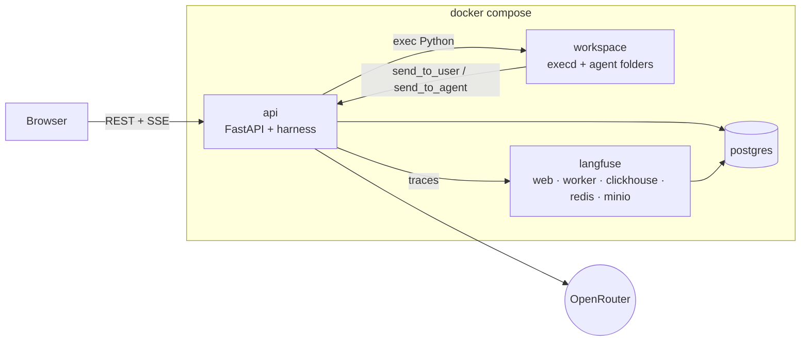

# 00 · Overview

VDaAgent is a multi-agent assistant for real-estate Sales Ops teams in Vietnam. A user asks a question in natural language, for example *"Vì sao căn MAS-U03832 bán chậm? So sánh với các căn tương đồng, vẽ biểu đồ và xuất báo cáo."*. A team of agents reads the company's data warehouse, analyses it, draws charts, writes a report, and sends the results back in a chat app. Reports are kept in a searchable library, and a business dashboard summarises inventory and transactions. Backend identifiers use the code prefix `contoso` (the `contoso` helper package, the `contoso_session` cookie).

This document set describes a **proof of concept (PoC)** of a grokbot-inspired architecture for that product. Each part is designed to work end to end, but not to production standards. Every shortcut is listed in [99-risks-and-future-work.md](99-risks-and-future-work.md) together with the way to replace it.

**What exists today.** The frontend is built and runs on mock services in the browser ([14](14-frontend.md)). The backend, the `workspace` sandbox and the compose stack are specified here but not built yet ([16](16-configuration-and-deployment.md#current-state)). Frontend docs mark every feature as *Implemented (mock)*, *Implemented (API)* or *Planned*.

English is the canonical version. [`vi/`](vi/00-overview.md) is a Vietnamese mirror with the same file names and structure. If the two disagree, the English file wins and the Vietnamese file must be fixed.

## Key ideas

1. **Everything is code.** An agent has one tool: run Python in its own agent folder.
2. **Silent by default.** The user sees only what an agent sends with `send_to_user`. Reasoning and tool output stay private.
3. **One global task at a time per user.** Each user's lead agent owns a FIFO task queue. The other agents help with the current task in parallel.
4. **Notifications, not interrupts.** Incoming messages are appended to the receiver's context. The receiver decides when to handle them.
5. **Knowledge lives in files.** Self-improvement and compaction both write to the agent folder, and each change is a git commit.
6. **Every agent is the same program.** Agents differ only by their folder, plus one flag (`is_lead`).

## Requirements

| Requirement | Meaning | Addressed in |
|---|---|---|
| Always on | Agents react to many triggers: user messages, the user opening the app, routines, other agents | [07](07-routing-and-queue.md), [09](09-routines.md) |
| Add and customize agents | Users create agents and customize them through a builder, with no code needed | [04](04-agent-folder.md), [05](05-agent-builder.md) |
| Multiple domains | Each domain (company or team) has its own credentials and its own starter agents | [12](12-auth-and-domains.md), [18](18-domains.md) |
| Self-improvement | Agents learn the user's preferences over time by editing their folder | [04](04-agent-folder.md), [06](06-context-and-compaction.md) |
| Agent communication | Agents work in parallel, 1-to-1 and in groups, with or without the user | [08](08-communication.md) |
| Long-horizon tasks | Context stays useful over days without bloating | [06](06-context-and-compaction.md) |
| Login and roles | Username and password login. Users belong to a domain; admins see everything | [12](12-auth-and-domains.md) |
| Observability | Langfuse for LLM monitoring, plus a chat-style trace of each agent | [13](13-observability.md) |
| Messenger-like UI | Grokbot-inspired chat app in light, dark and system themes, in Vietnamese and English; the look comes from the built frontend, the flows from this spec | [14](14-frontend.md), [0022](decisions/0022-ui-from-refactor-ux-from-spec.md) |
| Workspace pages | A reports library with versions, a business dashboard, an inbox of user notifications and personal settings | [19](19-reports-dashboard-notifications.md) |

## Architecture at a glance

Each user owns a team of agents:
- a built-in **lead**, which can't be deleted;
- the **starter** agents of the user's domain;
- any agents the user builds.

Each agent is a long-running model session plus a folder. The `api` service runs every session, and agent code runs only in the `workspace` container.

## PoC scope

**In scope:**
- Login, and the user and admin roles.
- One shipped domain, `fabrikam`, with six agents (admins can add more in Admin › Domains).
- The agent loop, routing, jev, the per-user global queue, routines and compaction.
- 1-to-1 and group threads.
- The agent builder: prompt, skills, libraries, routines and credential sets.
- The folder viewer with git history.
- Langfuse and the chat-trace view.
- Light, dark and system themes; a Vietnamese and English UI.
- The reports library, the business dashboard, user notifications and preferences.

**Out of scope (see [99](99-risks-and-future-work.md)):**
- Per-call sandbox isolation, and enforcing that agents can't read `.env`.
- BYOK.
- SSO.
- Horizontal scaling.
- Push notifications.
- Voice input.
- Message search.
- Upgrading existing agents when a template changes.

## Doc map

| File | Covers |
|---|---|
| [01-glossary.md](01-glossary.md) | Terms used everywhere |
| [02-architecture.md](02-architecture.md) | Services, the process model and the main request flows |
| [03-agent-loop.md](03-agent-loop.md) | The model loop, the Python tool, ending an activation, guards |
| [04-agent-folder.md](04-agent-folder.md) | Folder layout, how an agent is created, reset and deleted, git snapshots, the folder viewer |
| [05-agent-builder.md](05-agent-builder.md) | The builder's tabs, skills catalog, library presets, routines, credential sets |
| [06-context-and-compaction.md](06-context-and-compaction.md) | System prompt layers, rendering, `current_state`, offload, compaction |
| [07-routing-and-queue.md](07-routing-and-queue.md) | Triggers, deliveries, jev, the global task queue |
| [08-communication.md](08-communication.md) | Threads, `send_to_user`, `send_to_agent`, groups, attachments |
| [09-routines.md](09-routines.md) | Routine definitions and the scheduler |
| [10-data-model.md](10-data-model.md) | Postgres schema and invariants |
| [11-sandbox.md](11-sandbox.md) | The `workspace` container, `execd`, the `contoso` helper library, limits |
| [12-auth-and-domains.md](12-auth-and-domains.md) | Login, roles, domains, credentials, provisioning |
| [13-observability.md](13-observability.md) | Langfuse integration and the chat-trace view |
| [14-frontend.md](14-frontend.md) | Frontend target: stack, look, routes, chat layout, builder, realtime, gaps from the built mock |
| [14a](14a-frontend-architecture.md)–[14g](14g-frontend-development.md) | The built frontend: architecture, pages, adapters, mock chat, report viewer, report schema, development |
| [15-api.md](15-api.md) | Public, admin, internal and `execd` APIs |
| [16-configuration-and-deployment.md](16-configuration-and-deployment.md) | Repo layout, `.env`, compose, boot sequence, quick start |
| [17-testing.md](17-testing.md) | Test strategy, FakeModel, E2E |
| [18-domains.md](18-domains.md) | The `fabrikam` domain and its starter agents |
| [19-reports-dashboard-notifications.md](19-reports-dashboard-notifications.md) | Reports library, business dashboard, user notifications, preferences |
| [99-risks-and-future-work.md](99-risks-and-future-work.md) | Risks, open questions, PoC shortcuts |
| [decisions/](decisions/) | Decision records `0001`–`0022` |

### Decision records

| # | Decision |
|---|---|
| [0001](decisions/0001-one-global-queue-per-user-owned-by-the-lead.md) | One global task queue per user, owned by the lead |
| [0002](decisions/0002-jev-reads-the-receivers-view.md) | jev reads the receiver's view |
| [0003](decisions/0003-routines-run-only-when-the-owner-is-idle.md) | Routines run only when the owner is idle |
| [0004](decisions/0004-no-compaction-during-a-task.md) | No compaction during a task |
| [0005](decisions/0005-append-only-context-during-a-task.md) | Append-only context during a task |
| [0006](decisions/0006-one-api-process-hosts-the-harness.md) | One `api` process hosts the HTTP API and the harness |
| [0007](decisions/0007-shared-workspace-container-for-agent-code.md) | One shared `workspace` container runs all agent code |
| [0008](decisions/0008-platform-openrouter-key-no-byok.md) | One platform OpenRouter key, no BYOK |
| [0009](decisions/0009-domain-credentials-as-files.md) | Domain credentials are files, attached as credential sets |
| [0010](decisions/0010-per-user-agent-teams.md) | Every user has their own agent team |
| [0011](decisions/0011-built-in-lead-and-user-created-agents.md) | Built-in lead and user-created agents |
| [0012](decisions/0012-git-snapshot-per-exec.md) | A git snapshot after every exec |
| [0013](decisions/0013-langfuse-in-compose-plus-own-trace-view.md) | Langfuse in compose plus our own chat-trace view |
| [0014](decisions/0014-skill-catalog-in-db-with-own-installer.md) | Skill catalog in the DB, with our own installer |
| [0015](decisions/0015-library-presets-are-one-shot-installers.md) | Library presets are one-shot installers |
| [0016](decisions/0016-builder-edits-notify-then-apply-at-a-safe-point.md) | Builder edits notify the agent, then apply at a safe point |
| [0017](decisions/0017-send-to-user-may-end-the-activation.md) | `send_to_user` may end the activation |
| [0018](decisions/0018-single-global-admin-role.md) | A single global admin role |
| [0019](decisions/0019-retry-instead-of-llm-concurrency-cap.md) | Retry with backoff instead of capping LLM concurrency |
| [0020](decisions/0020-agents-publish-reports-and-dashboard-data.md) | Agents publish reports and dashboard data |
| [0021](decisions/0021-bilingual-ui.md) | A Vietnamese and English UI |
| [0022](decisions/0022-ui-from-refactor-ux-from-spec.md) | UI from the built frontend, UX from the spec |

## Reading order

- **To implement the harness:** 01 → 02 → 03 → 06 → 07 → 08 → 09 → 10 → 11.
- **To implement the product surface:** 12 → 04 → 05 → 14 → 19 → 15 → 13.
- **To work on the frontend today:** 14 → 14g → 14a → 14c.
- **To run it:** 16, then 17.
