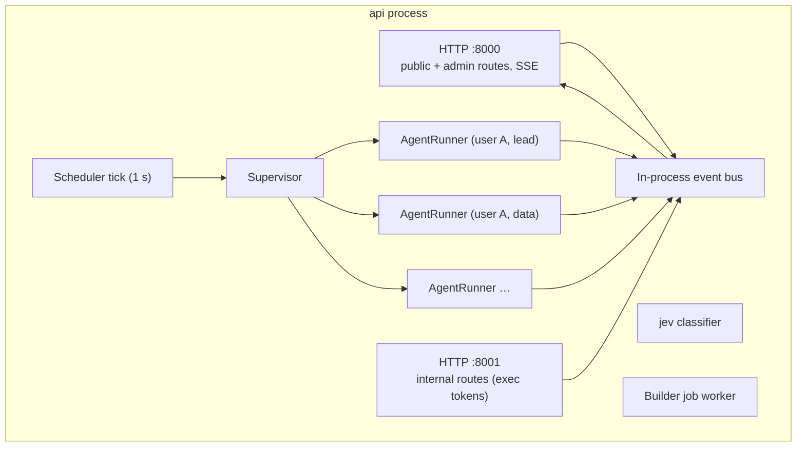
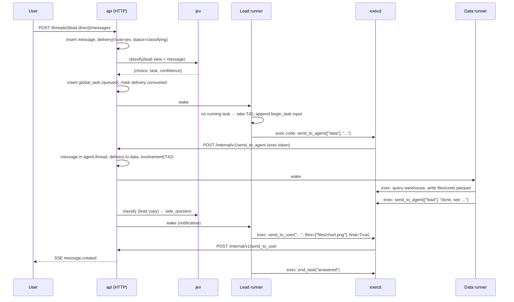

# 02 · Architecture

**Depends on:** [01](01-glossary.md).

## Services

| Service | Role | Holds secrets | Reaches |
|---|---|---|---|
| `api` | FastAPI HTTP API, the harness (agent runners, jev, queues, scheduler), SSE, the folder viewer, builder jobs | OpenRouter key, DB password, session secret, Langfuse keys, `EXECD_TOKEN` | `postgres`, `langfuse-web`, `workspace`, OpenRouter, GitHub |
| `workspace` | `execd`, the agent folders, the uv cache | `EXECD_TOKEN`; domain credentials (read-only mount) | `api` internal port, the internet (warehouse, GitHub, PyPI) |
| `postgres` (17) | App database `contoso` and Langfuse database `langfuse` | its own password | — |
| `langfuse-web`, `langfuse-worker`, `clickhouse`, `redis`, `minio` | LLM observability ([13](13-observability.md)) | their own generated secrets | `postgres` |

`workspace` is on the `exec` network only, so agent code can't reach Postgres or Langfuse. `api` is on both the `app` and `exec` networks. See [16](16-configuration-and-deployment.md).

## Process model inside `api`

`api` is one Python 3.12 asyncio process ([decision 0006](decisions/0006-one-api-process-hosts-the-harness.md)). Everything in memory can be rebuilt from Postgres and the folders, so a restart loses no state, only the steps that were running at the time ([03](03-agent-loop.md#restart)).



- **Supervisor.** Starts one `AgentRunner` task for each agent whose `state='active'`, of a user whose `status='active'` in an `available` domain. It restarts a runner that crashes (after a 5 s backoff, with an `error` event `restart`), and stops runners when an agent or user is disabled or deleted: a stop asks the runner to exit at its next idle point and cancels it after 5 s.
- **AgentRunner.** Owns one agent. It waits on a wake `asyncio.Event`, then runs activations ([03](03-agent-loop.md)). It also holds the agent's **job lock**, an `asyncio.Lock` shared with builder jobs, so two things never write the same folder at once. Wakes are sent after the transaction that created the work commits; an idle runner also re-checks every `RUNNER_POLL_S` (2 s), so a missed wake only delays work.
- **Internal API.** `:8001` is a second uvicorn server inside the same process and event loop (`backend/api/internal.py`), started at boot step 9.
- **jev classifier.** One background asyncio task per message delivered to a lead, serialized by a per-lead lock ([07](07-routing-and-queue.md#jev)).
- **Scheduler.** Every second it marks routines due ([09](09-routines.md)), enforces `TASK_MAX_S`, and wakes runners.
- **Event bus.** Fans out `message.created`, `agent.status`, `task.updated`, `thread.updated`, `builder.job` and raw `event.appended` to SSE subscribers, keyed by user id (and by agent id for admins).
- **Builder job worker.** Runs builder mutations that need `execd` (installs, removals, agent creation) under the agent's job lock ([05](05-agent-builder.md)).

### Package layout

The repo is a uv workspace (root `pyproject.toml`, members `agents/`, `backend/`, `eval/`). The `api` service is the `backend/` package, served as `backend.main:app` by uvicorn on port 8000. Compose and CI name the service `backend`; these docs call it `api`. The tree below is the target layout (**Status:** Planned, except `main.py`, `settings.py` and the `workspace/execd` placeholder from S0, `db/` from S1, and `auth/`, `api/`, `catalog/validate.py`, `domains/loader.py` and `validate.py`, `accounts.py` and `notifications.py` from S2). The HTTP layer is `api/`, not `http/`, so the package never shadows the standard library's `http` inside `backend`.

```text
backend/
  main.py            app factory, boot sequence, lifespan
  settings.py        pydantic-settings over the root .env
  db/                tables.py (SQLAlchemy Core), session.py, migrate.py (Alembic from code);
                     migrations in backend/alembic/
  auth/              passwords.py (argon2id), sessions.py, principal.py (CurrentUser), ratelimit.py
  domains/           loader.py (domain.yaml, starters, credential sets), validate.py (rules + upsert), provision.py
  catalog/           validate.py (seed validation), seeds.py (catalog upsert, S9)
  accounts.py        first admin, user management; notifications.py (user notifications)
  agents/            folders.py (create/reset/delete, path safety), viewer.py, gitops.py, builder.py, catalog.py
  harness/           supervisor.py, runner.py, render.py, model.py (OpenRouter + FakeModel), offload.py,
                     jev.py, queue.py, scheduler.py, compaction.py, tokens.py (exec tokens), notices.py
  messaging/         threads.py, messages.py, deliveries.py, attachments.py
  execd_client.py
  observability/     tracing.py (Langfuse), logging.py (structlog)
  api/               errors.py, middleware.py (X-Contoso-Client, cookie), deps.py (current_user, require_admin,
                     get_owned, domain check), auth.py, admin_users.py; later public, admin, internal, sse
workspace/
  execd/             app.py, run.py, snapshot.py
  contoso/               __init__.py (helpers), _client.py, skills.py (installer)
```

## Main flows

### A user asks the lead



### An exec call

1. The runner appends the `assistant` event carrying the tool call, and takes the job lock.
2. `api` creates an `exec_id` (`x_<ulid>`), signs an exec token, and registers `running_exec[agent_id] = exec_id`.
3. `api` calls `POST execd:7000/exec` with `{folder, code, exec_id, timeout_s, env_extra: {CONTOSO_API_URL, CONTOSO_EXEC_TOKEN, CONTOSO_DEFAULT_THREAD}}`.
4. Inside the exec, `contoso` helpers call `api:8001/internal/v1/*` with the token.
5. `execd` returns the result together with the snapshot fields. `api` offloads large output, appends the `tool_result` event, releases the lock, and clears `running_exec` after a 5 s grace period.

### A builder change

1. `POST /api/agents/{id}/skills {catalog_id}` inserts a `jobs` row and returns `202 {job_id}`.
2. The job worker takes the agent's job lock, then runs the catalog row's `install_cmd` as a system exec through `execd`.
3. `execd` makes the snapshot commit with the author given in the request, `user:<username>` ([04](04-agent-folder.md#git-snapshots)).
4. `api` inserts a notice delivery for the agent ("Kỹ năng mới: …") and wakes it.
5. The bus sends `builder.job` updates to the browser.

## Ports

| Port | Service | Published |
|---|---|---|
| 8000 | `api` public HTTP (`/api`); no longer serves the frontend | `127.0.0.1:${APP_PORT}` |
| 80 | `frontend` (nginx, SPA fallback, `infra/docker/frontend.Dockerfile`) | via reverse proxy |
| 8001 | `api` internal HTTP | no (reachable from `exec` network only) |
| 7000 | `execd` | no |
| 3000 | `langfuse-web` | `127.0.0.1:3100` |
| 5432 | `postgres` | no |

A Caddy reverse proxy in front routes `/api` to `backend:8000` and everything else to `frontend:80` (`infra/Caddyfile`; CI deploys it, and locally it runs as the optional compose service `proxy`, [16](16-configuration-and-deployment.md#compose)).
