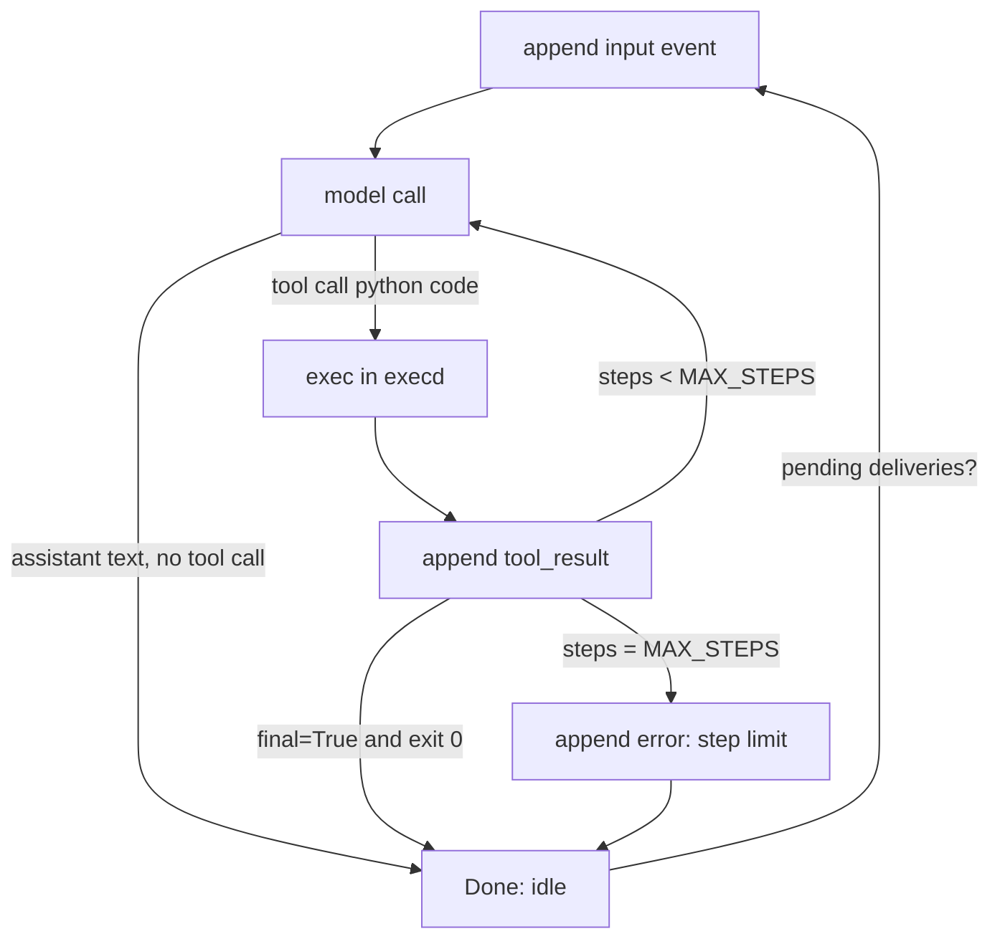

# 03 · Agent loop

How a single agent thinks and acts. **Depends on:** [01](01-glossary.md), [06](06-context-and-compaction.md), [11](11-sandbox.md).

## From session-based agents to grokbot

Session-based agents such as Claude Code and Codex show every action to the user and wait for approval. That fits a 1-to-1 application, but not a multi-agent one, where an agent's context extends far beyond a single user conversation. Here, input reaches an agent from users and other agents at any time, and replying to the user is optional.

## Activation

An **activation** runs from the moment an agent wakes until it is idle again. Each activation gets a fresh 32-hex `trace_id` ([13](13-observability.md)), which is stored on every event, message and jev decision it produces.

When the agent is idle, its runner picks its next work in this order:

| # | Work | Input appended | Activation kind |
|---|---|---|---|
| 1 | Pending deliveries (messages and notices) | one `input` event: `current_state` followed by every pending delivery, oldest first; all are marked `consumed` | `message` |
| 2 | Pending routine (oldest due first) | `current_state` + `<routine>` | `routine` |
| 3 | Pending compaction, at a safe point only | the compaction prompt ([06](06-context-and-compaction.md#compaction)) | `compaction` |
| 4 | **Lead only:** no task running and the queue isn't empty | `current_state` + `<begin_task>` | `task` |

If nothing is pending, the runner sets `status='idle'` and waits on its wake event. Rule 4 runs a pending compaction (rule 3) first, so the lead compacts between tasks.

## Step loop



1. The runner renders the context ([06](06-context-and-compaction.md#rendering)) and calls the model.
2. It appends the `assistant` event, which holds the text, any tool calls, usage and latency.
3. For each tool call, in order, it runs the exec and appends a `tool_result` event. One tool result follows each tool call id, as the OpenAI message format requires.
4. It repeats until one of these happens:
   - **Done:** the model returns a turn with no tool call. That text is private and nobody sees it.
   - **Final:** an exec that called `send_to_user(..., final=True)` exits with code 0 ([decision 0017](decisions/0017-send-to-user-may-end-the-activation.md)).
   - **Step limit:** `MAX_STEPS_PER_ACTIVATION` (default 50) model calls have been made. The runner appends an `error` event "step limit reached".
5. The agent goes idle. If deliveries are pending at that point, the next activation starts at once.

`status` is `busy` during message and task activations, `routine` (with `status_detail=<name>`) during routines, and `compacting` during compaction. Each change is published as `agent.status`.

## The Python tool

The model sees exactly one tool:

```json
{
  "type": "function",
  "function": {
    "name": "python",
    "description": "Run Python 3.12 in your agent folder (cwd). Use print() to see results. State persists only in files. Helpers: from contoso import send_to_user, send_to_agent, end_task.",
    "parameters": {
      "type": "object",
      "properties": {"code": {"type": "string", "description": "Python source to run"}},
      "required": ["code"]
    }
  }
}
```

The request sets `parallel_tool_calls: false`. If a model returns several tool calls anyway, they run in order, each as its own exec.

Each exec is a new process: `cd <folder> && .venv/bin/python -c <code>` ([11](11-sandbox.md)). Shell, files, web access, helpers, memory and skills are all reached through Python, for example `subprocess.run([...])`, `open(...)`, `httpx.get(...)`, or `from helpers import peers` (the cwd is on `sys.path`).

### Tool result format

This exact text is what the model sees, and what is stored in `payload.text`:

```text
exit_code: 0 · 1.4 s
--- stdout ---
<stdout, or its head and tail when offloaded>
--- stderr ---
<stderr, omitted when empty>
[output offloaded to .contoso/outputs/x_01J….txt (52,113 chars); showing first 2,000 and last 2,000]
[files changed: memory/preferences.md (M), helpers/peers.py (A)]
[2 notifications pending]
```

- A line is left out when it doesn't apply.
- A timeout prints `exit_code: killed (timeout 120 s)`.
- The **pending footer** lets the agent choose to end its block of work early, without the harness ever interrupting it.

## Talking to the user

- Reasoning, ordinary text and tool output are private. The user sees only what `send_to_user` sends ([08](08-communication.md)).
- Staying silent is allowed: if there is nothing new, the agent does not message the user.
- `send_to_user(..., final=True)` marks this exec as the last step of the activation. The flag applies only if the exec exits with code 0. If the code raises after sending, the message has already been delivered, the flag is ignored, and the model sees the error as usual.

## Model calls

- **Client.** An `httpx.AsyncClient` posting OpenAI-format chat completions to `OPENROUTER_BASE_URL/chat/completions` with `Authorization: Bearer OPENROUTER_API_KEY`, the headers `HTTP-Referer: <APP_URL>` and `X-Title: VDaAgent`, and `usage: {include: true}` (`harness/model.py`). It also sends `X-Contoso-Agent: <slug>` and `X-Contoso-Purpose: agent|compaction|jev`, which OpenRouter ignores and FakeModel uses to pick a script. (The `openai` SDK's current major version brings its own HTTP stack, which makes the FakeModel transport harder to plug in, so the PoC doesn't use it.)
- **Decisions API.** jev's calls (`ModelClient.decide`) go to `https://openrouter.ai/api/alpha/decisions` instead — a typed `choice` question in, a `{choice, confidence}` answer out, no chat messages and no sampling parameters (nothing to tune: the model is deterministic, not sampled text). Same key, same retry/backoff helper as chat completions ([07](07-routing-and-queue.md#classification)).
- **Models.** `AGENT_MODEL` for activations, `COMPACTION_MODEL` for compaction, `JEV_MODEL` for jev (default `typesafe/jev-1.14`, reached through the Decisions API above). One key serves all three ([decision 0008](decisions/0008-platform-openrouter-key-no-byok.md)).
- **Usage.** OpenRouter returns `usage.prompt_tokens`, `usage.completion_tokens`, `usage.prompt_tokens_details.cached_tokens` and `usage.cost` with every response. All four are stored on the `assistant` event.
- **Timeout.** `MODEL_TIMEOUT_S` (default 120).
- **Retry.** Responses 429 and 5xx, timeouts and connection errors are retried up to 3 times, with exponential backoff of 2, 4 and 8 s plus up to 1 s of jitter, honouring `Retry-After` ([decision 0019](decisions/0019-retry-instead-of-llm-concurrency-cap.md)). After the last failure, the runner appends an `error` event (`model_unavailable`) and the agent goes idle. Any deliveries the activation consumed stay in its context, so the next activation sees them.
- **Fake mode.** With `MODEL_BACKEND=fake`, `model.py` replays scripted responses ([17](17-testing.md)).

## Context limits during a step

Before each model call the runner estimates the context size. The estimate is the last `usage.prompt_tokens`, plus the characters appended since then divided by 3.5. The window size comes from the model's `context_length` (see [16](16-configuration-and-deployment.md)).

| Condition | Action |
|---|---|
| Estimate > `SOFT_CONTEXT_RATIO` × window (default 0.6) | Compaction becomes pending and runs at the next safe point |
| Estimate > `HARD_CONTEXT_RATIO` × window (default 0.9) | Batch offload ([06](06-context-and-compaction.md#offloading-large-outputs)) |
| Still above the hard limit after batch offload | Append `error` (`context_overflow`). If the agent is the lead and a task is running, the task becomes `failed` with outcome "context overflow". A system message tells the user in the thread that triggered the activation. The agent goes idle, and compaction is pending |

## Restart

At boot the supervisor reconciles state:

- **Interrupted agents.** Agents whose last event isn't followed by an idle point (`status` was `busy`, `routine` or `compacting`), or that had a lost exec (a graceful stop resets the status but still loses the step), get a notice: "The harness restarted; your last step was interrupted and its result is lost." They are woken.
- **Lost execs.** An exec that was running is lost. Its tool call gets a `tool_result` with `exit_code: lost (harness restart)`, so that every tool call still has a result. The same rule covers an exec that never reached `execd` while the harness ran: its result reads `exit_code: error (execd <code>: …)`.
- **Running global tasks** stay `running`. The lead gets a `task_resume` notice asking it to continue or call `end_task`.
- **Nothing is replayed** automatically.
