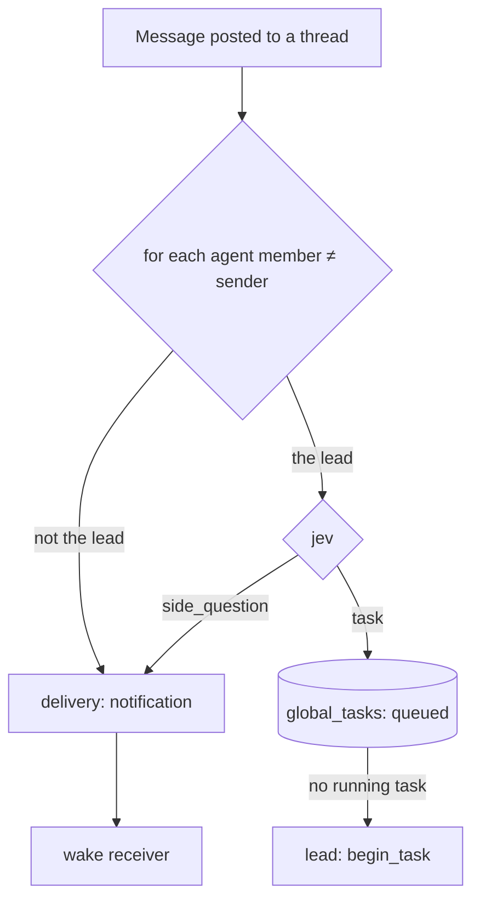
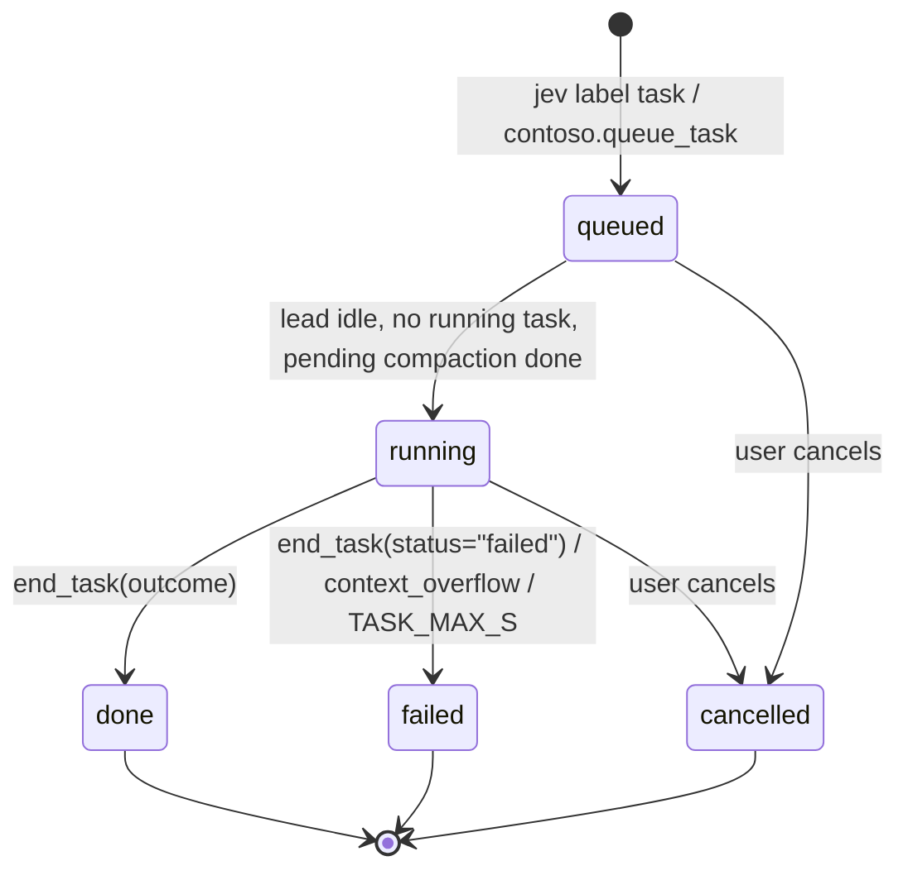

# 07 · Triggers, routing and the global task queue

What happens to each input before an agent sees it. **Depends on:** [01](01-glossary.md), [06](06-context-and-compaction.md), [08](08-communication.md).

## Triggers

| Trigger | Receiver | Classified by | Result |
|---|---|---|---|
| User message in a thread | every agent member of the thread | jev for the lead's copy; none for the others | lead: global task or notification; others: notification |
| Agent message (`send_to_agent`, or `send_to_user` into a group) | every other agent member of the thread | jev for the lead's copy | same as above |
| User opens the app (`POST /api/presence`, at most once per 30 min per user) | the lead | pre-classified | notice `presence` |
| Builder change, restart, task cancelled or timed out | the affected agent | pre-classified | notice |
| Routine fires | owner | pre-classified | routine pending ([09](09-routines.md)) |
| Compaction becomes pending | self | built-in | runs at a safe point ([06](06-context-and-compaction.md#compaction)) |



## Deliveries

- Posting a message inserts one `deliveries` row per receiving agent, inside the same transaction as the `messages` row. The sender never receives its own message.
- `route = 'jev'` for the lead's copy and `'notification'` for everyone else. A notice is a delivery with `notice` jsonb instead of `message_id`.
- A notification is appended to the end of the receiver's context at its next activation ([03](03-agent-loop.md#activation)). The receiver decides when to handle it: straight away if idle, otherwise after its current block of work. **The harness never interrupts a running loop.**
- **Involvement.** A message posted while the user has a running task inserts `task_involvement(task, agent)` for the sender, if it is an agent, and for every agent receiver.

## jev

jev classifies every delivery to the lead whose `route='jev'`. Neither the user's `POST` nor the sender's helper call waits for it:

- The delivery is inserted with `status='classifying'`, and the lead's runner ignores deliveries in that state.
- jev runs in a background asyncio task started after the message transaction commits.
- A per-lead `asyncio.Lock` makes jev calls for one lead run one at a time, in delivery order, so tasks are queued in the order their messages arrived.
- At boot, deliveries still in `classifying` are classified again.

### Context

```text
build_jev_ctx(lead, msg) =
    lead.current_state            # rendered now, including the running task and queue length
  + lead.summary                  # current epoch's summary
  + last K message events of lead # messages the lead sent or received, newest last; tool output excluded
  + msg                           # sender, thread, content, attachment names
```

- `K = JEV_K` (default 20). The message events come from `messages` joined with the lead's thread memberships, not from the lead's raw `events`.
- **Rendering** (`harness/jev.py`): the `current_state` block, then `<summary>` if not empty, then `<recent_messages>` with one `<m id from thread at>` per message, then the new message as `<message id from thread at>` with an `attachments:` line. jev decisions store `{"state": ..., "questions": ...}` as `input`.
- The rest of the system depends only on jev's output label, so this policy can change without touching anything else ([decision 0002](decisions/0002-jev-reads-the-receivers-view.md)).

### Classification

jev is a non-generative "System One" decision model (TypeSafe AI's Jev), reached through OpenRouter's Decisions API (`POST /api/alpha/decisions`, `ModelClient.decide`) with the same `OPENROUTER_API_KEY` as every other model call ([decision 0008](decisions/0008-platform-openrouter-key-no-byok.md)). It never generates text: the request is a single `choice` question (`route`) whose `criteria` come from `platform/jev_criteria.yaml` (operator-editable, read per call):

```yaml
task: "New, independent work that deserves its own place in the queue: a new analysis, report, comparison or piece of work that doesn't depend on the running task."
side_question: "Help, data or results for the current task; status questions; answers to a question the lead asked; thanks, greetings, small talk; corrections or additions to the running task."
```

The reply is `{choice, probabilities, confidence}` — a typed answer, never prose. **Model.** `JEV_MODEL` (default `typesafe/jev-1.14`). No sampling parameters: the Decisions API is deterministic, not sampled text, so there is nothing to tune.

**Confidence floor.** jev's `confidence` (0–1) is compared against `JEV_CONFIDENCE_FLOOR` (default `0.6`): below the floor, the stored `label` is forced to `side_question` regardless of which option jev preferred. This keeps the documented safety property — a request the lead can't confidently classify falls back to a notification instead of silently queuing behind the task it might depend on — visible in the data as a `side_question` row with a low `confidence` ([decision 0023](decisions/0023-jev-classifies-via-openrouter-decisions-api.md)).

### Effects

| Label | Effect |
|---|---|
| `task` | Insert `global_tasks(status='queued', description=<message text, truncated to 500 chars>, source_message_id)`, set the delivery to `consumed` (the lead sees it later, as part of `<begin_task>`), wake the lead |
| `side_question` | Set the delivery to `pending`, so the lead gets it as a notification; wake the lead |

**Failure.** On a timeout (10 s), a malformed response (missing `answers.route`, an unexpected `choice`), or a model error after the retries from [03](03-agent-loop.md#model-calls), the label is `side_question` with `fallback=true`. A message is never lost, because the lead sees it either way.

### Records

Every call inserts a `jev_decisions` row: `input` (`{state, questions}`), `label`, `confidence`, `model`, `latency_ms`, `fallback` and `trace_id`. jev never produces the task's title — that's always the source message's text, truncated to 500 chars. The jev call is also a `generation` named `jev` inside the trace of whoever posted the message ([13](13-observability.md)). In the chat-trace view, the admin can mark a decision as mislabelled, which sets `observed`. Comparing `label` with `observed` measures jev's accuracy.

## Global task queue

Each user has one FIFO queue in `global_tasks`, controlled only by that user's lead ([decision 0001](decisions/0001-one-global-queue-per-user-owned-by-the-lead.md)).



- **At most one running task per user.** A partial unique index enforces it: `UNIQUE (user_id) WHERE status='running'`.
- **Begin.** When the lead's runner reaches rule 4 ([03](03-agent-loop.md#activation)), it moves the oldest `queued` task to `running` (setting `started_at`), inserts `task_involvement(task, lead)`, and appends `<begin_task>` with the description and the original message.
- **End.** `contoso.end_task(outcome, status="done")` is for the lead only, and only for the running task. It sets `ended_at`, `outcome` and `ended_by='lead'`, publishes `task.updated`, and makes the lead's next idle point a safe point for every involved agent.
- **Cancel.** `POST /api/tasks/{id}/cancel` (by the user) sets `cancelled` and `ended_by='user'`. The lead and every involved agent get the notice `task_cancelled`, so they can stop.
- **Timeout.** The scheduler sets `failed` with `ended_by='timeout'` once `now - started_at > TASK_MAX_S` (default 3600), and sends the same notice.
- **The lead owns every global task.** It does the work itself or hands parts to other agents with `send_to_agent`.
- **`contoso.queue_task(description)`** (lead only) queues a task directly, for example when the lead decides that a side question is really new work.

### Requests from other agents

A non-lead agent creates a global task by sending a message to the lead. jev classifies it like a user message.

**Deadlock guard.** Requests sent to the lead for queuing must be for new, independent work only. Help needed for the *current* task must not become a queued task, because it would wait behind the very task that needs it. jev sees the running task in the lead's `current_state`, and the `side_question` criterion in `platform/jev_criteria.yaml` covers such requests. The lead can still fix a mislabel by calling `end_task` on the wrong task, or by handling the queued item itself.

### "User opened the app"

When the browser window gains focus, it calls `POST /api/presence`. The server sends the lead a `presence` notice only if the last one is more than 30 minutes old (it looks at the lead's last `presence` delivery, so the debounce survives a restart). Only the lead receives it, and the lead decides whether to say anything, for example a morning digest.
