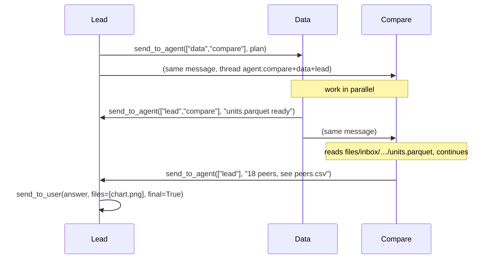

# 08 · Communication

How users and agents talk to each other. **Depends on:** [01](01-glossary.md), [07](07-routing-and-queue.md), [11](11-sandbox.md).

## Threads

Every message belongs to a thread, and a thread has a fixed kind and a member set.

| Kind | Members | Created | Visible to the user |
|---|---|---|---|
| `direct` | the user + 1 agent | with the agent; exactly one per agent | yes |
| `group` | the user + ≥ 2 agents | by the user ("Nhóm mới") | yes |
| `agent` | ≥ 2 agents, no user | on first `send_to_agent` between that exact member set | no (admin only) |

- **One rule for every kind: a message posted to a thread reaches every member except the sender.** Agents receive it as deliveries ([07](07-routing-and-queue.md#deliveries)); the user sees it in the UI if they are a member.
- **`agent` threads are found by `member_key`**, the sorted slugs joined with `+` (e.g. `chart+data+lead`), unique per user. A conversation between the same agents always lands in the same thread.
- **Group membership.** The user can rename a group and add or remove agents. Removing an agent doesn't delete its past messages. The lead is optional in a group; if it's a member, its copy goes through jev.
- **A deleted agent** is removed from groups. Its direct thread stays, read-only.

## `send_to_user`

```python
send_to_user(text: str | None = None, *, files: Sequence[str] = (), choices: Sequence[dict] | None = None,
             reports: Sequence[str] = (), thread: str | None = None, reply_to: str | None = None,
             final: bool = False) -> str  # message id
```

- **`thread`** defaults to `CONTOSO_DEFAULT_THREAD`:
  - in a `message` activation, the thread of the newest consumed delivery that came from the user;
  - in a `task` activation, the thread of the task's source message;
  - otherwise (routines, or input only from agents), the agent's direct thread.
- **Thread check.** The thread must include the user and the sending agent; `agent` threads, and threads the agent isn't in (another agent's direct thread), raise `ValueError` (400 `invalid_thread`). A read-only thread is 409 `thread_read_only`. In a group, the message also reaches the other agent members, under the single rule above.
- **`files`** are paths relative to the folder. Each must exist and be at most 20 MB, and there can be at most 10. `api` copies them to `/data/attachments/<message_id>/<name>` and records `sha256`, so later edits in the folder don't change what was sent.
- **`choices`** is `[{"id": "pdf", "label": "PDF"}, …]`, with at most 6. The UI shows them as chips. A click posts a normal user message with `content.choice_id` and `content.reply_to`, and its text is the choice's label.
- **`reports`** are report version ids (`"R7-v1"`) that the user owns, at most 5. They become `content.report_refs`, which the UI renders as report reference cards that open the saved version ([19](19-reports-dashboard-notifications.md#in-chat)). An unknown version raises `ValueError`.
- **`final=True`** ends the activation after this exec, if the exec exits with code 0 ([03](03-agent-loop.md#talking-to-the-user)).
- **During compaction** it raises `RuntimeError("messaging is disabled during compaction")`.

## `send_to_agent`

```python
send_to_agent(receivers: Sequence[str], content: str, *, files: Sequence[str] = (),
              thread: str | None = None, reply_to: str | None = None) -> str  # message id
```

- **`receivers`** are slugs from the same user's team. An unknown or deleted slug raises `ValueError`. The sender can't be a receiver.
- **With no `thread`,** the message goes to the `agent` thread whose members are `{sender} ∪ receivers`, created on first use.
- **With a `thread`,** it must be a `group` thread containing the sender and every receiver; the user then sees the message. `receivers` must equal the thread's other agent members, since every member receives every message.
- **`files`** are copied like user attachments, so the receiver reads them under `files/inbox/m_<message_id>/` in its own folder. Agents never read each other's folders directly.
- **Routing.** The lead's copy goes through jev; every other receiver gets a notification.

## Other helpers

| Helper | Who | Effect |
|---|---|---|
| `end_task(outcome: str, status: str = "done")` | lead | ends the running task ([07](07-routing-and-queue.md#global-task-queue)) |
| `queue_task(description: str)` | lead | queues a task directly |
| `write_summary(text: str)` | anyone, during compaction only | sets the summary of the next epoch |

## User attachments

- **Upload.** The user uploads files with `POST /api/threads/{id}/messages` (multipart), each up to 20 MB. They are stored once in `/data/attachments/<message_id>/`.
- **Copy into folders.** For each receiving agent, `api` copies the files to `files/inbox/m_<message_id>/<name>` in that agent's folder, before inserting the delivery. It commits them with author `contoso-harness` when the receiver's job lock is free. If the receiver is in the middle of an exec, the copy is left for that exec's snapshot to commit: waiting for the lock inside the posting call could deadlock two agents that message each other mid-exec. Duplicate names get ` (2)`, ` (3)`… suffixes.
- **Notification.** The notification lists those paths ([06](06-context-and-compaction.md#input-items)).

## Working together on a task

During a global task, the lead coordinates and the other agents work in parallel. Every message is a notification, so no agent is interrupted mid-block. An agent may receive a message and decide to do nothing; it simply stays idle.



## Visibility

| Viewer | Direct | Group | Agent thread | Private reasoning and tool output |
|---|---|---|---|---|
| The user | own | own | — | — |
| An admin | all | all | all | all (chat-trace view, [13](13-observability.md)) |
| Another user | — | — | — | — |
