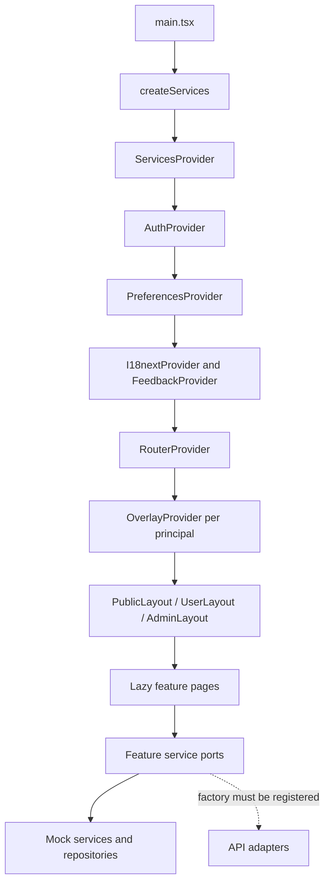

# 14a · Frontend architecture

**Depends on:** [14](14-frontend.md), [14c](14c-frontend-adapters.md), [decision 0022](decisions/0022-ui-from-refactor-ux-from-spec.md)

The frontend uses React 19, TypeScript and Vite, with React Router for routes and i18next for the Vietnamese/English UI. Exact dependency versions are locked in [`package.json`](../frontend/package.json) and `frontend/package-lock.json`.

## UI stack

**Status:** Implemented (mock)

The binding UI stack is this repo's: React 19, plain CSS with tokens (`frontend/src/shared/styles/tokens.css`), Radix primitives, i18next, GSAP motion and the own SVG chart renderer (`shared/charts`). See [decision 0022](decisions/0022-ui-from-refactor-ux-from-spec.md). The spec's Tailwind/shadcn/TanStack Query/Shiki/react-virtual stack is not used.

There is no query-cache library. The spec's realtime rule "on SSE reconnect, invalidate everything" is met by re-reading the service ports after reconnect: each mounted page reissues its reads through its feature port. **Status:** Planned (no SSE transport exists yet; see [14](14-frontend.md#current-implementation-vs-target)).

## Source map

| Directory | Responsibility |
| --- | --- |
| [`src/app`](../frontend/src/app) | Service bootstrap, router, layouts, shell, providers and workspace integration. |
| [`src/features`](../frontend/src/features) | Auth, dashboard, reports, chat, notifications, settings, admin-users; each feature owns its pages, model and service port. |
| [`src/mocks`](../frontend/src/mocks) | Fixtures, repositories, scenarios and mock implementations of the ports. |
| [`src/shared/contracts`](../frontend/src/shared/contracts) | Shared auth, preferences, service result, feature registration and notification target contracts. |
| [`src/shared/ui`](../frontend/src/shared/ui) | Buttons, forms, identity, feedback, page, tables, pagination and overlays. |
| [`src/shared/charts`](../frontend/src/shared/charts) | Chart contract, compatibility checks, SVG renderer, data tables and chart expansion. |
| [`src/shared/motion`](../frontend/src/shared/motion) | GSAP analytical-motion lifecycle. |
| [`src/shared/styles`](../frontend/src/shared/styles) | Tokens and base CSS. |
| [`tests`](../frontend/tests) | Integration tests, shared-domain tests and Playwright journeys. |

## Startup and composition

[`main.tsx`](../frontend/src/main.tsx) reads `VITE_SERVICE_MODE`, creates `Services` and renders `App` inside `StrictMode`. Service configuration errors have their own startup screen. See [14c](14c-frontend-adapters.md) for how implementations are registered.

`ErrorBoundary` wraps the app tree. `App` creates the browser router per mount lifecycle and disposes it on cleanup. `UserLayout` also provides user-notification state through `NotificationsProvider`.

[`feature-registry.ts`](../frontend/src/app/feature-registry.ts) combines the core features (chat, notifications, settings) with dashboard, reports and admin-users from [`integrations/workspace.ts`](../frontend/src/app/integrations/workspace.ts). Each `FeatureRegistration` declares route, role, layout, frame, lazy loader and navigation order. `validateRegistrations` checks routes and roles. Auth registers the `/login` loader separately.

The router checks the session before mounting a page. Today `USER` lands on `/` and `ADMIN` on `/admin/users`; the target landing differs (see [14b](14b-frontend-pages.md#routes-and-access)). Route guards serve the UI only; adapters and the backend still enforce data access.

## Data boundaries

Pages get dependencies through `useServices` or `useWorkspaceService`. Service interfaces live in `features/*/services`; [`Services`](../frontend/src/app/services/services.ts) is the app's dependency contract, independent of the mock factory's return type.

Feature repositories are an internal data boundary. For example `ReportsService` takes the app principal; the mock integration maps that principal to the permission scope used by `ReportsRepository`. The two `Principal` types (shared auth and report model) serve different layers.

Report content is projected from exactly `detail.version`. `deriveReportVersionSummary` keeps the saved-version identity; `deriveReportDashboardView` picks the compact report overview layout; `ReportDocument` renders the full document. Business dashboard values are never used to fill a report snapshot. Details in [14e](14e-report-viewer.md).

One deliberate exception: the pre-auth desktop reads a public projection of the Riverside fixture through `auth/desktop/preview-model.ts` and does not call the protected reports service. Riverside chat content is also built in the mock layer from the canonical report source, then reaches the UI through `ChatService`.

## State and lifecycle

| State | Owner | Identity or lifecycle |
| --- | --- | --- |
| Session | AuthProvider / AuthService | Principal and expiry time. |
| Preferences and preview | PreferencesProvider | Per principal; `public` scope before login. |
| Dashboard, reports, admin filters | URL | Business scope, sort, pagination, open object. |
| Open report | URL and service read | `report`, `version`, `view`; request identity includes principal. |
| Scroll, expanded chart | Ref/state in the viewer | Lives while the viewer is mounted; expansion resets on identity/mode change. |
| Conversations, messages and drafts | ChatService / ChatPage | Conversation ID, message ID, request ID and sequence. |
| Read state | NotificationsProvider / service | Optimistic update with failure handling; per principal. |
| Account status change | Status controller / AdminUsersService | Revision and operation ID; confirmation before mutation. |
| Desktop windows | Reducer in PreAuthDesktop | Window position, order and state for the mount. |

[`useServiceRead`](../frontend/src/features/reports/hooks/useServiceRead.ts) aborts stale requests and never publishes outdated results. On version change the viewer shows loading while the new version is read. The reports list read key excludes `report`, `version`, `view`, so switching viewer content does not re-read the list because of those three params.

There is no separate query-cache library in the current dependencies. If a cache is added, its identity must include the principal and the full relevant scope/version.

## Mock storage

**Status:** Implemented (mock)

| Data | Current mechanism |
| --- | --- |
| Demo session | `sessionStorage` via storage adapter, `public` scope. |
| Preferences | `localStorage`, per principal or `public`. |
| User-notification read map | `localStorage`, per principal. |
| Chat inspector open/closed | `sessionStorage`, per principal. |
| Chat bundle, history and drafts | IndexedDB `vdaagent-demo`, version 2, object store `scopes`, key = principal ID. |
| Report/dashboard fixtures and demo admin changes | Mock runtime repositories/memory. |

Storage adapters use the `vdaagent:v1:` prefix. When browser storage is unavailable, adapters fall back to memory and set a degraded flag. The chat repository validates what it reads and migrates v1 bundles to v2; draft attachments must be re-attached after reload. Messages still pending/responding on reload become interrupted.

Data reset in Settings only resets chat and user-notification read state for the current account; preferences are kept. It is not a reset of the whole dataset or the backend database.

## UI and motion

`tokens.css` defines color, typography, spacing, radius, elevation and motion; `globals.css` applies theme, density, focus and base rules. Be Vietnam Pro is bundled via `@fontsource`; icons use Lucide plus brand assets in `public/icon`.

The shell uses role-based navigation, a rail on desktop and a drawer on narrow screens. Chat has an agent picker, timeline and inspector; below the CSS breakpoints the side areas become drawers (target: one pane at a time, see [14](14-frontend.md#current-implementation-vs-target)). The report viewer uses one Radix dialog for both report overview and document; chart expansion lives inside that dialog.

PreferencesProvider manages theme, locale, timezone, density and reduced motion. Authored report/conversation content keeps its source language; changing locale changes control labels and display formatting.

[`useAnalyticalMotion`](../frontend/src/shared/motion/useAnalyticalMotion.ts) manages the GSAP context and cleanup. Reveals never change numbers, coordinates or data gaps. OS or app reduced-motion preference skips the effects. The pre-auth desktop has its own motion hook in `auth/desktop`.

Layered test guidance is in [14g](14g-frontend-development.md).
