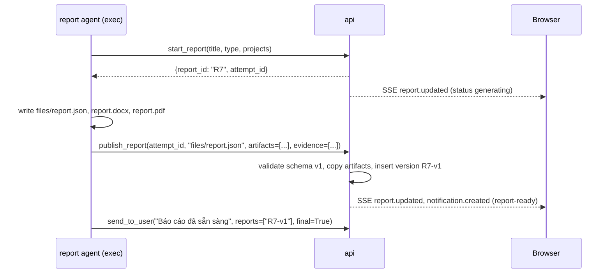

# 19 · Reports library, business dashboard, user notifications and preferences

The frontend already ships four workspace features that the original PoC spec didn't cover: the reports library (`/reports`), the business dashboard (`/`), the user notification inbox (`/notifications`) and personal settings (`/setting`). This document gives each of them a backend that follows the PoC rules. **Depends on:** [08](08-communication.md), [10](10-data-model.md), [11](11-sandbox.md), [12](12-auth-and-domains.md), [14](14-frontend.md), [15](15-api.md#workspace-extensions).

**Status:** backend Implemented (API): `backend/reports/`, `backend/api/{reports,dashboard,inbox}.py`, the internal report/dataset routes. The frontend for all four is Implemented (mock) ([14b](14b-frontend-pages.md)); its API adapters are S12a.

**Implementation notes.** Artifacts are stored under `/data/reports/<version uuid>/` (version codes repeat across users). Artifact `mediaType` is the real type, including PDF, DOCX and XLSX; the frontend `Artifact.mediaType` union (HTML, CSV) must be widened in S12a. `policyVersion` is `report-policy-v1` and `contentRevision` the first 16 hex characters of the stored schema's sha256. A `publish_report` without `source` records `{id: "agent:<slug>", completeness: "partial"}`. Ending an attempt that already ended is 409 `attempt_ended`.

**One instant per version.** `publish` stamps `report_versions.completed_at` from Python (`datetime.now(UTC)`) instead of the column default `now()`, which in Postgres is the *transaction* start, and it derives the default `source.dataThrough` from that same instant. Before this, an omitted `source` produced a `dataThrough` milliseconds **after** `completed_at`, so the reader handed the UI a source newer than its own version, `decodeReportVersion` rejected it ("Report source is newer than saved version"), and — because the reports list decodes every row at once — the whole library rendered "Chưa đọc được báo cáo". `backend/tests/harness/test_reports_internal.py::test_publish_without_a_source_keeps_the_version_readable` guards it. On the reader side, a version the decoder rejects for any reason other than an identity mismatch degrades to `schemaIssue` on that row alone (`frontend/src/adapters/api/reports.ts`), so one legacy version cannot blank the library. Rows published before the fix keep their original `completed_at`: `report_versions` is immutable, so they cannot be corrected in place.

**Absent optionals are omitted, never `null`.** JSON has no `undefined`, and the frontend's `optional()` helpers reject an explicit `null`, so an absent optional field must be left out of the stored schema. `backend/reports/schema.py` therefore omits a chart's `type`, `description`, `dimension.unit` and `semantic` when the agent did not send them (block `description`/`span` and metric `definition`/`comparison` were already dropped). Writing `"unit": null` instead made `decodeReportSchema` fail, which the viewer shows as "Phiên bản schema chưa được hỗ trợ" — a report published with five correct `chart` blocks then rendered without any chart. `backend/tests/reports/test_schema.py::test_an_absent_optional_is_omitted_never_stored_as_null` guards the writer, and `frontend/src/features/reports/tests/schema.test.ts` covers a chart already stored with `null` optionals, because published versions are immutable and must stay readable.

## Principles

1. **Agents publish; `api` never reads the warehouse.** Domain credentials stay in agent folders ([12](12-auth-and-domains.md#credentials-flow)). Reports and dashboard data reach `api` only through `contoso` helpers that an agent calls from its own code ([decision 0020](decisions/0020-agents-publish-reports-and-dashboard-data.md)).
2. **Everything is owned by one user.** Every row has `user_id`, every query filters on it, and another user's resource returns 404 `not_found` ([12](12-auth-and-domains.md#roles-and-authorization)). Admins have no team, so they have no reports, dashboard or inbox content of their own.
3. **The frontend contracts are the wire shapes.** Response bodies use the shapes of the existing frontend domain types (`frontend/src/features/*/model/types.ts`, `frontend/src/shared/contracts/*`), in camelCase, so the API adapters stay thin ([14c](14c-frontend-adapters.md)). The core spec API keeps its snake_case shapes.
4. **Saved means immutable.** A published report version, its artifacts and its evidence never change. A new version is a new row.

## Reports library

### Lifecycle

| Helper | Internal endpoint | Effect |
|---|---|---|
| `start_report(title, type, *, projects=(), markets=(), report_id=None)` | `POST /internal/v1/reports/start` | Creates the report record (unless `report_id` names an existing one of this user) and a `running` attempt. Returns `{report_id, attempt_id}`. |
| `publish_report(attempt_id, schema_path, *, artifacts=(), evidence=(), source=None)` | `POST /internal/v1/reports/publish` | Validates and stores a new version; the attempt becomes `succeeded`. Returns the version id. |
| `fail_report(attempt_id, reason)` | `POST /internal/v1/reports/fail` | The attempt becomes `failed` with `reason`. |

- **Ids.** Report ids are `R<n>`, numbered per user. Version ids are `<report_id>-v<sequence>`, matching the identities the frontend already uses (`R010-v2`).
- **Schema.** `schema_path` is a folder-relative JSON file in [report schema v1](14f-report-schema.md). The agent leaves `reportId` and `versionId` out; `api` fills them in before validation.
- **Validation** applies the rules of the frontend decoder `decodeReportSchema` ([14f](14f-report-schema.md#decoder-and-fallback)): `schemaVersion` 1, matching identity, evidence ids that belong to this version, no duplicate metric or block ids, complete table rows, valid `span`, section depth ≤ 8, scope dates `[from, to)` with an IANA timezone, finite numbers or `null`. A failure returns 400 `invalid_report` with the first problem in `message`; the attempt stays `running`, so the agent can fix the file and publish again. The frontend decoder still runs on every read; it stays the last line of defence.
- **Artifacts.** At most 10 files of at most 20 MB, with media types HTML, CSV, DOCX, PDF or XLSX. `api` copies them to `/data/reports/<version_id>/<filename>` and records `sha256`, as it does for attachments ([08](08-communication.md#send_to_user)). A version without artifacts is valid; the viewer then shows no download button.
- **Evidence** is a list of `{id, label, sourceId, projectIds, snapshotId, dataThrough, limitation}`; `source` is `{id, label, dataThrough, completeness}`. `dataThrough` may not be later than the publish time.
- **Attempts end with their work.** When a global task ends (any status), every attempt it started that is still `running` becomes `failed` with reason `task_ended`. An attempt started outside a task (for example by a routine) fails after `TASK_MAX_S`. The scheduler enforces both ([07](07-routing-and-queue.md)).
- **Status** is derived exactly as the frontend's [`lifecycle.ts`](../frontend/src/features/reports/model/lifecycle.ts) does it: a report with a saved version is `completed` even if a newer attempt failed. Without a saved version, a `queued` or `running` attempt makes it `generating`, a `failed` one makes it `failed`, a `succeeded` attempt without output makes it `unsupported`, and no attempt makes it `draft`.

### Reading

The frontend `ReportsService` port maps one-to-one onto the endpoints in [15](15-api.md#reports). Search, filters, sort and pagination use the rules of the current mock, ported to Python (`backend/reports/read.py`, a copy of `selectReports`/`summarizeRecord`/`paginate` run over the user's own reports, so the two sides can't drift) ([14e](14e-report-viewer.md), [14b](14b-frontend-pages.md)): case- and accent-insensitive search on code, title, project and author (Unicode NFD without marks, `đ`→`d`, lower-case, the same as the frontend `fold`), at most 500 characters; repeated keys mean "any of"; pages of 25, 50 or 100. The catalog (`GET /api/reports/catalog`) returns the user's projects (from the latest dashboard dataset plus the projects named by reports), the user as the only author, the slugs of the user's agents, the report types seen in the user's reports, and the default scope (the last 30 days in the dataset's business timezone, or `Asia/Ho_Chi_Minh`).

### In chat

`send_to_user(..., reports=["R7-v1"])` adds `report_refs` to the message ([08](08-communication.md#send_to_user)). The chat renders each one as a report reference card that opens `/reports?report=R7&version=R7-v1&view=dashboard` ([14](14-frontend.md#centre-pane-conversation)). A version that doesn't exist or belongs to another user returns 400 `invalid_request`.

## Business dashboard

### Dataset

The business dashboard at `/` is computed from one **dataset** per user. The dataset moves through three places:

1. **Agent folder.** An agent with the `warehouse` credentials (normally `data`) queries the warehouse from its own code and writes a JSON file in its folder, for example `files/dashboard.json`.
2. **Postgres.** `publish_dataset("dashboard", "files/dashboard.json")` makes `api` read that file from the shared `folders` volume, validate it and store a copy as a row of `datasets` (`payload jsonb`, [10](10-data-model.md#datasets)). After that, changing the file has no effect on the dashboard until it is published again.
3. **Browser.** `GET /api/dashboard/dataset` returns the newest row, and the browser computes the dashboard from it ([Computation](#computation)).

None of this is built yet. Today the mock dashboard reads generated fixtures from [`mocks/dashboard/fixtures.ts`](../frontend/src/mocks/dashboard/fixtures.ts) (`createDashboardFixtures`).

| Helper | Internal endpoint | Effect |
|---|---|---|
| `publish_dataset(kind, path)` | `POST /internal/v1/datasets/publish` | Stores the JSON file at `path` as the user's newest dataset of `kind`. Only `kind="dashboard"` exists. |

- **Shape.** The file is a `DashboardDataset` ([`dashboard/model/types.ts`](../frontend/src/features/dashboard/model/types.ts)) without `tasks` and `taskSource`: `businessTimezone`, `projects`, `snapshots` (inventory snapshots with their properties), `transactions`, `transactionSource` and `coveredDates`. Missing days are left out of `coveredDates`; absence means unknown, never zero.
- **Validation.** At most 20 MB; required fields and types; ISO dates; an IANA `businessTimezone`; every property and transaction names a known project. A failure returns 400 `invalid_dataset`.
- **Storage.** `datasets` keeps the five newest datasets per user and kind; reads use the newest.
- **Refresh.** Nothing refreshes the dataset on its own, and no starter ships a routine for it. The user asks an agent (normally `data`, which holds the `warehouse` credentials) to rebuild and publish it, or sets up a routine for that in the builder's **Lịch** tab ([05](05-agent-builder.md#routines)); an agent may also create such a routine itself. Until the first publish, the dashboard shows its empty state ([Computation](#computation)).

### Tasks on the dashboard

`GET /api/dashboard/dataset` adds `tasks` and `taskSource` from the user's report attempts: each attempt becomes an `AnalysisTask` (`queued`/`running`/`succeeded`/`failed`, its report and version, and its first project). That is what the dashboard's task KPIs and the AT02 attention rule count.

### Computation

`api` does not compute KPIs. The API adapter of `DashboardService` loads the dataset once per scope change and runs the existing pure functions in [`features/dashboard/model`](../frontend/src/features/dashboard/model) (age bands, slow-inventory share, transaction trend, attention rules AT01–AT03, breakdown pages), with the report aggregate and recent reports from the reports endpoints. The rules and their tests therefore stay in one place. The cost is that the whole dataset travels to the browser; see [99](99-risks-and-future-work.md).

When the user has no dataset yet, the endpoint returns `{"dataset": null}` and the inventory and transaction sections show their empty state; the reports and tasks sections still work.

## User notifications

A **user notification** is an item in the inbox at `/notifications`. It is unrelated to agent-side notifications ([01](01-glossary.md)).

| Event | Kind | Target | Preference group |
|---|---|---|---|
| A report version is published | `report-ready` | the report version | `reports` |
| A report attempt fails, or a global task ends `failed` or by timeout | `task-failed` | the report, or the lead's direct thread | `tasks` |
| An agent sends a message with `choices` | `action-required` | the thread | `tasks` |
| An admin creates the account | `account-created` | the account (`/setting`) | always sent |
| An admin resets the password or disables the account, or the user's domain becomes unavailable | `system` | the notice itself | `system` |

- **Preferences decide at creation time.** If the user has turned a group off in `/setting`, `api` doesn't create notifications of that group. Turning it back on doesn't bring back skipped items.
- **Text** comes from fixed templates in both languages (`title` and `summary` as `{vi, en}`), so the inbox follows the user's locale without a server round trip. Agent text is never copied into a user notification.
- **`access`** is computed when the inbox is read: `available` if the target exists and belongs to the user, otherwise `missing`. (`restricted` stays in the frontend contract for future shared resources; `api` doesn't emit it.)
- **Read state.** `POST /api/notifications/read` marks the given ids, or every unread one when no ids are given. The frontend's optimistic update and rollback stay as they are ([14b](14b-frontend-pages.md)).
- **Realtime.** `notification.created` and `notification.read` go out on the user's SSE stream; the unread count in the shell updates from them.
- **Retention.** `api` keeps the 500 newest per user and deletes older ones at boot.
- **Not here:** push notifications, email or Zalo delivery ([99](99-risks-and-future-work.md)).

## Preferences

- **Display name** lives in `users.display_name` (at most 100 characters; saving preferences requires 1–100). `GET /api/auth/me` returns it, and saving preferences updates it. When it is empty, the UI shows the username.
- **The rest** (`locale` `vi`/`en`, `theme` `light`/`dark`/`system`, `timezone`, `motion`, `density`, notification groups) is one `jsonb` value in `user_preferences`, validated with the rules of the frontend's [`isPreferences`](../frontend/src/shared/contracts/preferences.ts). An invalid body returns 400 `invalid_request`.
- **Theme toggle.** The quick toggle in the app header ([14](14-frontend.md#shell)) and the settings page write the same `theme` preference.
- **Before login,** preferences live only in the browser, in the `public` scope ([14a](14a-frontend-architecture.md#mock-storage)).
- **Timezone is for display only.** Routines keep using `Asia/Ho_Chi_Minh`, and dashboard business dates use the dataset's `businessTimezone`.
- **Locale** changes control labels and number and date formats. Agent messages and saved reports keep the language they were written in ([decision 0021](decisions/0021-bilingual-ui.md)).

## Pre-auth desktop

The desktop at `/login` keeps its preview windows. Their content is static, public material bundled with the frontend (today the Riverside fixture projection, [14b](14b-frontend-pages.md)); there is no endpoint and no protected data before login. Its login window posts to `POST /api/auth/login` with a username ([12](12-auth-and-domains.md#login-poc-grade)).

## What stays mock-only

- **"Reset demo data"** in `/setting` resets the browser-side mock stores only. The API has no equivalent.
- **Mock scenarios** (`?scenario=`) select mock behaviour only ([14g](14g-frontend-development.md)).
