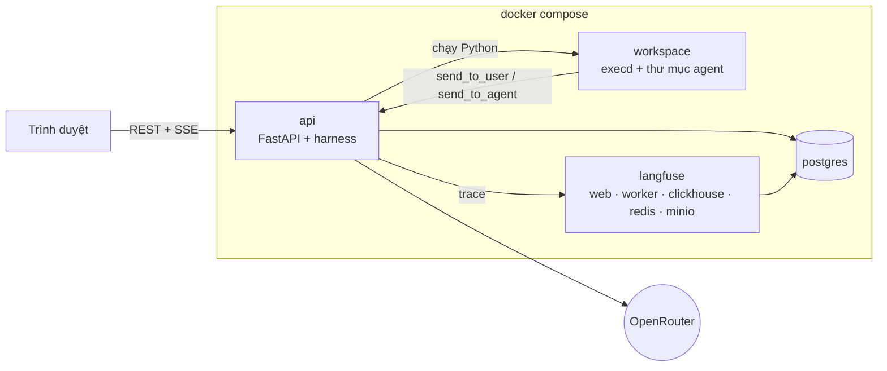

# 00 · Tổng quan

VDaAgent là trợ lý đa agent dành cho Sales Ops bất động sản tại Việt Nam. Người dùng đặt câu hỏi bằng ngôn ngữ tự nhiên, ví dụ *"Vì sao căn MAS-U03832 bán chậm? So sánh với các căn tương đồng, vẽ biểu đồ và xuất báo cáo."*; một nhóm agent đọc kho dữ liệu của công ty, phân tích, vẽ biểu đồ, viết báo cáo và gửi kết quả trong một ứng dụng chat. Báo cáo được lưu trong một thư viện có tìm kiếm, và một dashboard nghiệp vụ tóm tắt tồn kho và giao dịch. Các định danh backend dùng tiền tố code `contoso` (gói helper `contoso`, cookie `contoso_session`).

Bộ tài liệu này mô tả một **proof of concept (PoC)** của kiến trúc lấy cảm hứng từ grokbot cho sản phẩm đó. Mỗi phần được thiết kế để chạy được từ đầu đến cuối, nhưng chưa đạt chuẩn production; mọi chỗ làm tắt được liệt kê trong [99-risks-and-future-work.md](99-risks-and-future-work.md) kèm cách thay thế.

**Hiện có gì.** Frontend đã được xây dựng và chạy trên mock service trong trình duyệt ([14](14-frontend.md)). Backend, sandbox `workspace` và stack compose được đặc tả ở đây nhưng chưa được xây dựng ([16](16-configuration-and-deployment.md#hiện-trạng)). Tài liệu frontend gắn cho mọi tính năng một nhãn *Đã có (mock)*, *Đã có (API)* hoặc *Dự kiến*.

Bản tiếng Anh ([`../`](../00-overview.md)) là bản chuẩn; thư mục `vi/` này là bản dịch có cùng tên file và cấu trúc. Khi hai bản khác nhau, bản tiếng Anh đúng và bản tiếng Việt phải được sửa.

## Ý tưởng chính

1. **Mọi thứ là code.** Agent chỉ có một tool: chạy Python trong thư mục agent của chính nó.
2. **Im lặng là mặc định.** Người dùng chỉ thấy những gì agent gửi bằng `send_to_user`; suy luận và output của tool là riêng tư.
3. **Mỗi người dùng chỉ một task toàn cục tại một thời điểm.** Lead của mỗi người dùng sở hữu một hàng đợi task FIFO; các agent khác cùng giúp task hiện tại song song.
4. **Thông báo, không ngắt.** Tin đến được nối vào cuối context của người nhận; người nhận tự quyết khi nào xử lý.
5. **Tri thức nằm trong file.** Tự cải thiện và compaction đều ghi vào thư mục agent; mỗi thay đổi là một git commit.
6. **Mọi agent là cùng một chương trình.** Agent chỉ khác nhau ở thư mục, cộng một cờ (`is_lead`).

## Yêu cầu

| Yêu cầu | Ý nghĩa | Xử lý ở |
|---|---|---|
| Luôn hoạt động | Agent phản ứng với nhiều trigger: tin của người dùng, người dùng mở app, lịch chạy, agent khác | [07](07-routing-and-queue.md), [09](09-routines.md) |
| Thêm/tuỳ biến agent | Người dùng tạo và tuỳ biến agent qua builder, không cần viết code | [04](04-agent-folder.md), [05](05-agent-builder.md) |
| Nhiều miền | Mỗi miền (công ty/nhóm) có credentials và agent mẫu riêng | [12](12-auth-and-domains.md), [18](18-domains.md) |
| Tự cải thiện | Agent học sở thích người dùng theo thời gian bằng cách sửa thư mục của mình | [04](04-agent-folder.md), [06](06-context-and-compaction.md) |
| Giao tiếp giữa agent | Song song, 1-1 và nhóm, có hoặc không có người dùng | [08](08-communication.md) |
| Task dài hạn | Context vẫn hữu ích qua nhiều ngày mà không phình to | [06](06-context-and-compaction.md) |
| Đăng nhập và vai trò | Đăng nhập bằng tên/mật khẩu; người dùng thuộc một miền; admin thấy mọi thứ | [12](12-auth-and-domains.md) |
| Quan sát hệ thống | Langfuse theo dõi LLM, cộng một trace dạng chat cho từng agent | [13](13-observability.md) |
| UI kiểu messenger | App chat lấy cảm hứng grokbot với giao diện sáng, tối và theo hệ thống, bằng tiếng Việt và tiếng Anh; phần nhìn lấy từ frontend đã xây dựng, các luồng lấy từ đặc tả này | [14](14-frontend.md), [0022](decisions/0022-ui-from-refactor-ux-from-spec.md) |
| Các trang workspace | Thư viện báo cáo có phiên bản, dashboard nghiệp vụ, hộp thư thông báo người dùng (user notification) và cài đặt cá nhân | [19](19-reports-dashboard-notifications.md) |

## Kiến trúc tóm tắt

Mỗi người dùng sở hữu một nhóm agent:
- một **lead** có sẵn, không xoá được;
- các agent **mẫu** của miền người dùng thuộc về;
- các agent do người dùng tự tạo.

Mỗi agent là một phiên model chạy lâu dài cộng một thư mục. Service `api` chạy mọi phiên, còn code của agent chỉ chạy trong container `workspace`.

## Phạm vi PoC

**Trong phạm vi:**
- Đăng nhập, cùng hai vai trò người dùng và admin.
- Một miền đi kèm, `fabrikam`, với sáu agent (quản trị viên thêm miền khác trong Quản trị › Miền dữ liệu).
- Vòng lặp agent, định tuyến, jev, hàng đợi toàn cục theo người dùng, lịch chạy và compaction.
- Hội thoại 1-1 và nhóm.
- Builder agent: prompt, kỹ năng, thư viện, lịch chạy và bộ credentials.
- Trình xem thư mục kèm lịch sử git.
- Langfuse và chế độ xem trace dạng chat.
- Giao diện sáng, tối và theo hệ thống; UI tiếng Việt và tiếng Anh.
- Thư viện báo cáo, dashboard nghiệp vụ, thông báo người dùng (user notification) và tuỳ chọn cá nhân.

**Ngoài phạm vi (xem [99](99-risks-and-future-work.md)):**
- Cô lập sandbox theo từng lần chạy, và cưỡng chế agent không đọc được `.env`.
- BYOK.
- SSO.
- Mở rộng ngang.
- Thông báo đẩy.
- Nhập bằng giọng nói.
- Tìm kiếm tin nhắn.
- Nâng cấp agent đã có khi template thay đổi.

## Bản đồ tài liệu

| File | Nội dung |
|---|---|
| [01-glossary.md](01-glossary.md) | Thuật ngữ dùng khắp nơi |
| [02-architecture.md](02-architecture.md) | Các service, mô hình tiến trình, luồng chính |
| [03-agent-loop.md](03-agent-loop.md) | Vòng lặp model, tool Python, kết thúc activation, các giới hạn |
| [04-agent-folder.md](04-agent-folder.md) | Cấu trúc thư mục, tạo/khôi phục/xoá agent, snapshot git, trình xem thư mục |
| [05-agent-builder.md](05-agent-builder.md) | Các tab của builder, kho kỹ năng, preset thư viện, lịch chạy, bộ credentials |
| [06-context-and-compaction.md](06-context-and-compaction.md) | Các lớp system prompt, cách render, `current_state`, offload, compaction |
| [07-routing-and-queue.md](07-routing-and-queue.md) | Trigger, delivery, jev, hàng đợi task toàn cục |
| [08-communication.md](08-communication.md) | Hội thoại, `send_to_user`, `send_to_agent`, nhóm, tệp đính kèm |
| [09-routines.md](09-routines.md) | Định nghĩa lịch chạy và bộ lập lịch |
| [10-data-model.md](10-data-model.md) | Schema Postgres và các bất biến |
| [11-sandbox.md](11-sandbox.md) | Container `workspace`, `execd`, thư viện helper `contoso`, giới hạn |
| [12-auth-and-domains.md](12-auth-and-domains.md) | Đăng nhập, vai trò, miền, credentials, cấp phát người dùng |
| [13-observability.md](13-observability.md) | Tích hợp Langfuse và chế độ xem trace dạng chat |
| [14-frontend.md](14-frontend.md) | Đích của frontend: stack, giao diện, route, bố cục chat, builder, realtime, khác biệt so với bản mock đã xây dựng |
| [14a](14a-frontend-architecture.md)–[14g](14g-frontend-development.md) | Frontend đã xây dựng: kiến trúc, các trang, adapter, chat mock, trình xem báo cáo, schema báo cáo, phát triển |
| [15-api.md](15-api.md) | API public, admin, internal và `execd` |
| [16-configuration-and-deployment.md](16-configuration-and-deployment.md) | Cấu trúc repo, `.env`, compose, trình tự khởi động, bắt đầu nhanh |
| [17-testing.md](17-testing.md) | Chiến lược test, FakeModel, E2E |
| [18-domains.md](18-domains.md) | Miền `fabrikam` và agent mẫu |
| [19-reports-dashboard-notifications.md](19-reports-dashboard-notifications.md) | Thư viện báo cáo, dashboard nghiệp vụ, thông báo người dùng (user notification), tuỳ chọn |
| [99-risks-and-future-work.md](99-risks-and-future-work.md) | Rủi ro, câu hỏi mở, chỗ làm tắt của PoC |
| [decisions/](decisions/) | Các bản ghi quyết định `0001`–`0022` |

### Bản ghi quyết định

| # | Quyết định |
|---|---|
| [0001](decisions/0001-one-global-queue-per-user-owned-by-the-lead.md) | Mỗi người dùng một hàng đợi task toàn cục, do lead sở hữu |
| [0002](decisions/0002-jev-reads-the-receivers-view.md) | jev đọc góc nhìn của người nhận |
| [0003](decisions/0003-routines-run-only-when-the-owner-is-idle.md) | Lịch chạy chỉ chạy khi chủ sở hữu rảnh |
| [0004](decisions/0004-no-compaction-during-a-task.md) | Không compaction giữa task |
| [0005](decisions/0005-append-only-context-during-a-task.md) | Context chỉ nối thêm trong lúc task chạy |
| [0006](decisions/0006-one-api-process-hosts-the-harness.md) | Một tiến trình `api` chứa cả HTTP API và harness |
| [0007](decisions/0007-shared-workspace-container-for-agent-code.md) | Một container `workspace` dùng chung chạy mọi code của agent |
| [0008](decisions/0008-platform-openrouter-key-no-byok.md) | Một key OpenRouter của nền tảng, không BYOK |
| [0009](decisions/0009-domain-credentials-as-files.md) | Credentials của miền là file, gắn vào agent theo bộ |
| [0010](decisions/0010-per-user-agent-teams.md) | Mỗi người dùng có nhóm agent riêng |
| [0011](decisions/0011-built-in-lead-and-user-created-agents.md) | Lead có sẵn và agent do người dùng tạo |
| [0012](decisions/0012-git-snapshot-per-exec.md) | Snapshot git sau mỗi lần chạy |
| [0013](decisions/0013-langfuse-in-compose-plus-own-trace-view.md) | Langfuse trong compose cộng chế độ xem trace riêng |
| [0014](decisions/0014-skill-catalog-in-db-with-own-installer.md) | Kho kỹ năng trong DB, dùng trình cài đặt riêng |
| [0015](decisions/0015-library-presets-are-one-shot-installers.md) | Preset thư viện là trình cài một lần |
| [0016](decisions/0016-builder-edits-notify-then-apply-at-a-safe-point.md) | Thay đổi từ builder: báo ngay, áp dụng đầy đủ ở điểm an toàn |
| [0017](decisions/0017-send-to-user-may-end-the-activation.md) | `send_to_user` có thể kết thúc activation |
| [0018](decisions/0018-single-global-admin-role.md) | Một vai trò admin toàn cục duy nhất |
| [0019](decisions/0019-retry-instead-of-llm-concurrency-cap.md) | Thử lại có backoff thay vì giới hạn số lời gọi LLM đồng thời |
| [0020](decisions/0020-agents-publish-reports-and-dashboard-data.md) | Agent xuất bản báo cáo và dữ liệu dashboard |
| [0021](decisions/0021-bilingual-ui.md) | UI tiếng Việt và tiếng Anh |
| [0022](decisions/0022-ui-from-refactor-ux-from-spec.md) | UI từ frontend đã xây dựng, UX từ đặc tả |

## Thứ tự đọc

- **Để triển khai harness:** 01 → 02 → 03 → 06 → 07 → 08 → 09 → 10 → 11.
- **Để triển khai phần sản phẩm:** 12 → 04 → 05 → 14 → 19 → 15 → 13.
- **Để làm frontend hiện nay:** 14 → 14g → 14a → 14c.
- **Để chạy hệ thống:** 16, rồi 17.
