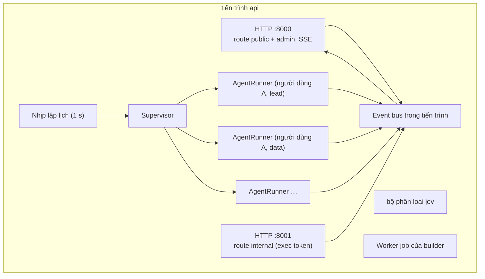
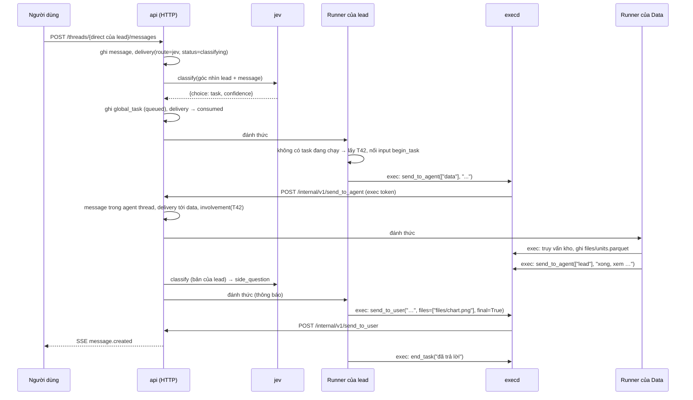

# 02 · Kiến trúc

**Phụ thuộc:** [01](01-glossary.md).

## Các service

| Service | Vai trò | Giữ bí mật | Kết nối tới |
|---|---|---|---|
| `api` | HTTP API (FastAPI), harness (runner của agent, jev, hàng đợi, bộ lập lịch), SSE, trình xem thư mục, job của builder | key OpenRouter, mật khẩu DB, session secret, key Langfuse, `EXECD_TOKEN` | `postgres`, `langfuse-web`, `workspace`, OpenRouter, GitHub |
| `workspace` | `execd`, các thư mục agent, cache uv | `EXECD_TOKEN`; credentials của miền (mount chỉ đọc) | cổng internal của `api`, internet (kho dữ liệu, GitHub, PyPI) |
| `postgres` (17) | DB ứng dụng `contoso` và DB Langfuse `langfuse` | mật khẩu của nó | — |
| `langfuse-web`, `langfuse-worker`, `clickhouse`, `redis`, `minio` | quan sát LLM ([13](13-observability.md)) | các secret tự sinh của chúng | `postgres` |

`workspace` chỉ nằm trên mạng `exec`, nên code của agent không tới được Postgres hay Langfuse. `api` nằm trên cả hai mạng `app` và `exec`. Xem [16](16-configuration-and-deployment.md).

## Mô hình tiến trình trong `api`

`api` là một tiến trình asyncio Python 3.12 ([quyết định 0006](decisions/0006-one-api-process-hosts-the-harness.md)). Mọi thứ trong bộ nhớ đều dựng lại được từ Postgres và các thư mục, nên khởi động lại không mất trạng thái, chỉ mất những bước đang chạy lúc đó ([03](03-agent-loop.md#khởi-động-lại)).



- **Supervisor.** Khởi động một task `AgentRunner` cho mỗi agent có `state='active'`, của người dùng có `status='active'` trong một miền `available`. Nó khởi động lại runner bị lỗi (sau backoff 5 s, kèm event `error` mã `restart`), và dừng runner khi agent hoặc người dùng bị vô hiệu hoá hay xoá: lệnh dừng yêu cầu runner thoát ở điểm rảnh kế tiếp và huỷ nó sau 5 s.
- **AgentRunner.** Sở hữu một agent. Nó chờ trên một `asyncio.Event` đánh thức, rồi chạy các activation ([03](03-agent-loop.md)). Nó cũng giữ **job lock** của agent, một `asyncio.Lock` dùng chung với job của builder, để không bao giờ có hai thứ cùng ghi một thư mục. Lệnh đánh thức được gửi sau khi transaction tạo ra việc đã commit; runner đang rảnh cũng kiểm tra lại mỗi `RUNNER_POLL_S` (2 s), nên lỡ một lần đánh thức chỉ làm việc chậm lại.
- **Internal API.** `:8001` là một server uvicorn thứ hai trong cùng tiến trình và event loop (`backend/api/internal.py`), khởi động ở bước boot 9.
- **Bộ phân loại jev.** Một task asyncio nền cho mỗi tin gửi đến lead, chạy tuần tự nhờ một khoá riêng cho từng lead ([07](07-routing-and-queue.md#jev)).
- **Bộ lập lịch.** Mỗi giây nó đánh dấu các lịch chạy đến hạn ([09](09-routines.md)), áp `TASK_MAX_S`, và đánh thức runner.
- **Event bus.** Phát `message.created`, `agent.status`, `task.updated`, `thread.updated`, `builder.job` và `event.appended` thô tới các subscriber SSE, theo user id (và theo agent id cho admin).
- **Worker job của builder.** Chạy các thay đổi của builder cần `execd` (cài, gỡ, tạo agent) dưới job lock của agent ([05](05-agent-builder.md)).

### Cấu trúc package

Repo là một uv workspace (`pyproject.toml` gốc, các thành viên `agents/`, `backend/`, `eval/`). Service `api` là package `backend/`, chạy bằng uvicorn dưới dạng `backend.main:app` trên cổng 8000. Compose và CI đặt tên service là `backend`; tài liệu này gọi là `api`. Cây dưới đây là cấu trúc mục tiêu (**Trạng thái:** Dự kiến, trừ `main.py`, `settings.py` và phần giữ chỗ `workspace/execd` từ S0, `db/` từ S1, và `auth/`, `api/`, `catalog/validate.py`, `domains/loader.py` và `validate.py`, `accounts.py` và `notifications.py` từ S2). Tầng HTTP là `api/`, không phải `http/`, để package không bao giờ che module `http` của thư viện chuẩn bên trong `backend`.

```text
backend/
  main.py            app factory, trình tự khởi động, lifespan
  settings.py        pydantic-settings đọc .env gốc
  db/                tables.py (SQLAlchemy Core), session.py, migrate.py (Alembic từ code);
                     migration trong backend/alembic/
  auth/              passwords.py (argon2id), sessions.py, principal.py (CurrentUser), ratelimit.py
  domains/           loader.py (domain.yaml, agent mẫu, bộ credentials), validate.py (quy tắc + upsert), provision.py
  catalog/           validate.py (kiểm tra seed), seeds.py (upsert kho, S9)
  accounts.py        admin đầu tiên, quản lý người dùng; notifications.py (thông báo người dùng)
  agents/            folders.py (tạo/khôi phục/xoá, an toàn đường dẫn), viewer.py, gitops.py, builder.py, catalog.py
  harness/           supervisor.py, runner.py, render.py, model.py (OpenRouter + FakeModel), offload.py,
                     jev.py, queue.py, scheduler.py, compaction.py, tokens.py (exec token), notices.py
  messaging/         threads.py, messages.py, deliveries.py, attachments.py
  execd_client.py
  observability/     tracing.py (Langfuse), logging.py (structlog)
  api/               errors.py, middleware.py (X-Contoso-Client, cookie), deps.py (current_user, require_admin,
                     get_owned, kiểm tra miền), auth.py, admin_users.py; sau này public, admin, internal, sse
workspace/
  execd/             app.py, run.py, snapshot.py
  contoso/               __init__.py (helper), _client.py, skills.py (trình cài)
```

## Các luồng chính

### Người dùng hỏi lead



### Một lần exec

1. Runner nối event `assistant` mang lời gọi tool, và lấy job lock.
2. `api` tạo một `exec_id` (`x_<ulid>`), ký một exec token, và đăng ký `running_exec[agent_id] = exec_id`.
3. `api` gọi `POST execd:7000/exec` với `{folder, code, exec_id, timeout_s, env_extra: {CONTOSO_API_URL, CONTOSO_EXEC_TOKEN, CONTOSO_DEFAULT_THREAD}}`.
4. Bên trong exec, các helper `contoso` gọi `api:8001/internal/v1/*` bằng token.
5. `execd` trả kết quả cùng các trường snapshot. `api` offload output lớn, nối event `tool_result`, nhả khoá, và xoá `running_exec` sau 5 s ân hạn.

### Một thay đổi từ builder

1. `POST /api/agents/{id}/skills {catalog_id}` ghi một dòng `jobs` và trả `202 {job_id}`.
2. Worker lấy job lock của agent, rồi chạy `install_cmd` của dòng kho như một system exec qua `execd`.
3. `execd` tạo commit snapshot với tác giả được truyền trong request, `user:<username>` ([04](04-agent-folder.md#snapshot-git)).
4. `api` ghi một delivery notice cho agent ("Kỹ năng mới: …") và đánh thức nó.
5. Bus gửi các cập nhật `builder.job` tới trình duyệt.

## Cổng

| Cổng | Service | Publish |
|---|---|---|
| 8000 | HTTP public của `api` (`/api`); không còn phục vụ frontend | `127.0.0.1:${APP_PORT}` |
| 80 | `frontend` (nginx, fallback SPA, `infra/docker/frontend.Dockerfile`) | qua reverse proxy |
| 8001 | HTTP internal của `api` | không (chỉ tới được từ mạng `exec`) |
| 7000 | `execd` | không |
| 3000 | `langfuse-web` | `127.0.0.1:3100` |
| 5432 | `postgres` | không |

Một reverse proxy Caddy đứng trước, chuyển `/api` tới `backend:8000` và phần còn lại tới `frontend:80` (`infra/Caddyfile`; CI triển khai file này, và ở máy cục bộ nó chạy như service compose tùy chọn `proxy`, [16](16-configuration-and-deployment.md#compose)).
