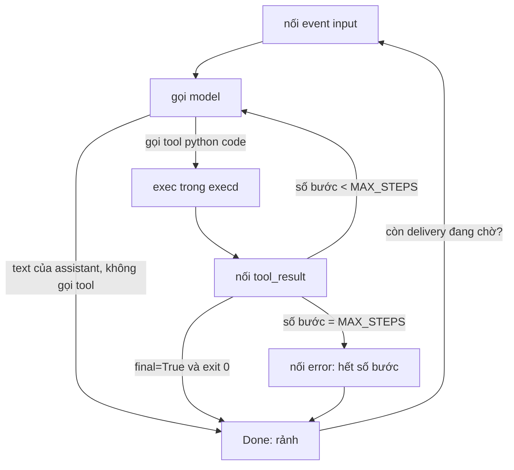

# 03 · Vòng lặp agent

Một agent suy nghĩ và hành động thế nào. **Phụ thuộc:** [01](01-glossary.md), [06](06-context-and-compaction.md), [11](11-sandbox.md).

## Từ agent theo phiên đến grokbot

Agent theo phiên như Claude Code hay Codex cho người dùng thấy mọi hành động và chờ duyệt. Cách đó hợp với ứng dụng 1-1, nhưng không hợp với hệ đa agent, nơi context của một agent vượt xa một cuộc trò chuyện với một người dùng. Ở đây, input đến từ người dùng và agent khác bất cứ lúc nào, và việc trả lời người dùng là tuỳ chọn.

## Activation

Một **activation** kéo dài từ lúc agent thức dậy đến khi nó rảnh trở lại. Mỗi activation có một `trace_id` 32 ký tự hex mới ([13](13-observability.md)), được lưu trên mọi event, tin nhắn và quyết định jev mà nó tạo ra.

Khi agent rảnh, runner chọn việc tiếp theo theo thứ tự sau:

| # | Việc | Input được nối | Loại activation |
|---|---|---|---|
| 1 | Delivery đang chờ (tin nhắn và notice) | một event `input`: `current_state` rồi mọi delivery đang chờ, cũ trước; tất cả được đánh dấu `consumed` | `message` |
| 2 | Lịch chạy đang chờ (đến hạn sớm nhất trước) | `current_state` + `<routine>` | `routine` |
| 3 | Compaction đang chờ, chỉ ở điểm an toàn | prompt compaction ([06](06-context-and-compaction.md#compaction)) | `compaction` |
| 4 | **Chỉ lead:** không có task đang chạy và hàng đợi không rỗng | `current_state` + `<begin_task>` | `task` |

Nếu không có gì đang chờ, runner đặt `status='idle'` và chờ sự kiện đánh thức. Quy tắc 4 chạy compaction đang chờ (quy tắc 3) trước, nên lead compaction giữa hai task.

## Vòng lặp bước



1. Runner render context ([06](06-context-and-compaction.md#cách-render)) và gọi model.
2. Nó nối event `assistant`, chứa text, các lời gọi tool, usage và độ trễ.
3. Với mỗi lời gọi tool, theo thứ tự, nó chạy exec rồi nối một event `tool_result`. Mỗi id lời gọi tool có đúng một kết quả, như định dạng tin nhắn OpenAI yêu cầu.
4. Lặp lại cho đến khi xảy ra một trong các trường hợp sau:
   - **Done:** model trả về một lượt không gọi tool. Text đó là riêng tư, không ai thấy.
   - **Final:** một exec đã gọi `send_to_user(..., final=True)` thoát với mã 0 ([quyết định 0017](decisions/0017-send-to-user-may-end-the-activation.md)).
   - **Hết số bước:** đã gọi model `MAX_STEPS_PER_ACTIVATION` lần (mặc định 50). Runner nối event `error` "step limit reached".
5. Agent chuyển sang rảnh. Nếu lúc đó còn delivery đang chờ, activation tiếp theo bắt đầu ngay.

`status` là `busy` trong activation tin nhắn và task, `routine` (kèm `status_detail=<name>`) khi chạy lịch, và `compacting` khi compaction. Mỗi lần đổi được phát dưới dạng `agent.status`.

## Tool Python

Model chỉ thấy đúng một tool:

```json
{
  "type": "function",
  "function": {
    "name": "python",
    "description": "Run Python 3.12 in your agent folder (cwd). Use print() to see results. State persists only in files. Helpers: from contoso import send_to_user, send_to_agent, end_task.",
    "parameters": {
      "type": "object",
      "properties": {"code": {"type": "string", "description": "Python source to run"}},
      "required": ["code"]
    }
  }
}
```

Request đặt `parallel_tool_calls: false`. Nếu model vẫn trả nhiều lời gọi tool, chúng chạy theo thứ tự, mỗi lời gọi là một exec riêng.

Mỗi exec là một tiến trình mới: `cd <folder> && .venv/bin/python -c <code>` ([11](11-sandbox.md)). Shell, file, web, helper, trí nhớ và kỹ năng đều được dùng qua Python, ví dụ `subprocess.run([...])`, `open(...)`, `httpx.get(...)`, hay `from helpers import peers` (cwd nằm trong `sys.path`).

### Định dạng kết quả tool

Đây đúng là text model nhìn thấy, và cũng là text được lưu vào `payload.text`:

```text
exit_code: 0 · 1.4 s
--- stdout ---
<stdout, hoặc đầu và đuôi khi đã offload>
--- stderr ---
<stderr, bỏ qua khi rỗng>
[output offloaded to .contoso/outputs/x_01J….txt (52,113 chars); showing first 2,000 and last 2,000]
[files changed: memory/preferences.md (M), helpers/peers.py (A)]
[2 notifications pending]
```

- Dòng nào không áp dụng thì bị bỏ.
- Khi hết giờ, dòng đầu là `exit_code: killed (timeout 120 s)`.
- **Dòng báo việc đang chờ** cho phép agent tự chọn kết thúc khối công việc sớm, mà harness không bao giờ phải ngắt.

## Nói với người dùng

- Suy luận, text thường và output của tool là riêng tư. Người dùng chỉ thấy những gì `send_to_user` gửi ([08](08-communication.md)).
- Im lặng là được phép: nếu không có gì mới, agent không nhắn người dùng.
- `send_to_user(..., final=True)` đánh dấu exec này là bước cuối của activation. Cờ chỉ có hiệu lực nếu exec thoát với mã 0. Nếu code lỗi sau khi gửi, tin nhắn đã được gửi, cờ bị bỏ qua, và model thấy lỗi như bình thường.

## Gọi model

- **Client.** Một `httpx.AsyncClient` gửi chat completion định dạng OpenAI tới `OPENROUTER_BASE_URL/chat/completions` với `Authorization: Bearer OPENROUTER_API_KEY`, header `HTTP-Referer: <APP_URL>` và `X-Title: VDaAgent`, và `usage: {include: true}` (`harness/model.py`). Nó cũng gửi `X-Contoso-Agent: <slug>` và `X-Contoso-Purpose: agent|compaction|jev`; OpenRouter bỏ qua, còn FakeModel dùng để chọn kịch bản. (Bản major hiện tại của SDK `openai` dùng HTTP stack riêng, khó gắn transport của FakeModel, nên PoC không dùng nó.)
- **Decisions API.** Lời gọi của jev (`ModelClient.decide`) đi tới `https://openrouter.ai/api/alpha/decisions` thay vì chat completions — gửi vào một câu hỏi `choice` có kiểu, nhận lại `{choice, confidence}`, không có message chat và không có tham số sampling (không gì để chỉnh: model quyết định, không sinh văn bản ngẫu nhiên). Dùng chung key và chung helper thử lại/backoff với chat completions ([07](07-routing-and-queue.md#phân-loại)).
- **Model.** `AGENT_MODEL` cho activation, `COMPACTION_MODEL` cho compaction, `JEV_MODEL` cho jev (mặc định `typesafe/jev-1.14`, gọi qua Decisions API ở trên). Một key dùng cho cả ba ([quyết định 0008](decisions/0008-platform-openrouter-key-no-byok.md)).
- **Usage.** OpenRouter trả `usage.prompt_tokens`, `usage.completion_tokens`, `usage.prompt_tokens_details.cached_tokens` và `usage.cost` trong mọi response. Cả bốn được lưu trên event `assistant`.
- **Timeout.** `MODEL_TIMEOUT_S` (mặc định 120).
- **Thử lại.** Response 429 và 5xx, timeout và lỗi kết nối được thử lại tối đa 3 lần, với backoff luỹ thừa 2, 4 và 8 s cộng tối đa 1 s ngẫu nhiên, và tôn trọng `Retry-After` ([quyết định 0019](decisions/0019-retry-instead-of-llm-concurrency-cap.md)). Sau lần thất bại cuối, runner nối event `error` (`model_unavailable`) và agent chuyển sang rảnh. Các delivery activation đã tiêu thụ vẫn nằm trong context, nên activation sau vẫn thấy chúng.
- **Chế độ giả.** Với `MODEL_BACKEND=fake`, `model.py` phát lại các phản hồi theo kịch bản ([17](17-testing.md)).

## Giới hạn context trong một bước

Trước mỗi lần gọi model, runner ước lượng kích thước context. Ước lượng là `usage.prompt_tokens` lần gần nhất cộng số ký tự đã nối thêm kể từ đó chia 3.5. Kích thước cửa sổ lấy từ `context_length` của model ([16](16-configuration-and-deployment.md)).

| Điều kiện | Hành động |
|---|---|
| Ước lượng > `SOFT_CONTEXT_RATIO` × cửa sổ (mặc định 0.6) | Compaction chuyển sang chờ, và chạy ở điểm an toàn kế tiếp |
| Ước lượng > `HARD_CONTEXT_RATIO` × cửa sổ (mặc định 0.9) | Offload hàng loạt ([06](06-context-and-compaction.md#offload-output-lớn)) |
| Vẫn vượt ngưỡng cứng sau offload hàng loạt | Nối `error` (`context_overflow`). Nếu agent là lead và có task đang chạy, task chuyển `failed` với outcome "context overflow". Một tin hệ thống báo người dùng trong hội thoại đã kích hoạt activation. Agent chuyển sang rảnh, và compaction chuyển sang chờ |

## Khởi động lại

Khi khởi động, supervisor đối chiếu lại trạng thái:

- **Agent bị gián đoạn.** Agent mà event cuối không đi kèm một điểm rảnh (`status` đang là `busy`, `routine` hay `compacting`), hoặc có exec bị mất (dừng êm vẫn đặt lại status nhưng bước đó vẫn mất), nhận notice: "The harness restarted; your last step was interrupted and its result is lost." Chúng được đánh thức.
- **Exec bị mất.** Exec đang chạy lúc đó bị mất. Lời gọi tool của nó nhận một `tool_result` với `exit_code: lost (harness restart)`, để mọi lời gọi tool vẫn có kết quả. Quy tắc này cũng áp dụng cho exec không tới được `execd` khi harness đang chạy: kết quả của nó là `exit_code: error (execd <code>: …)`.
- **Task toàn cục đang chạy** vẫn giữ `running`. Lead nhận một notice `task_resume` yêu cầu tiếp tục hoặc gọi `end_task`.
- **Không tự động phát lại** bất cứ thứ gì.
