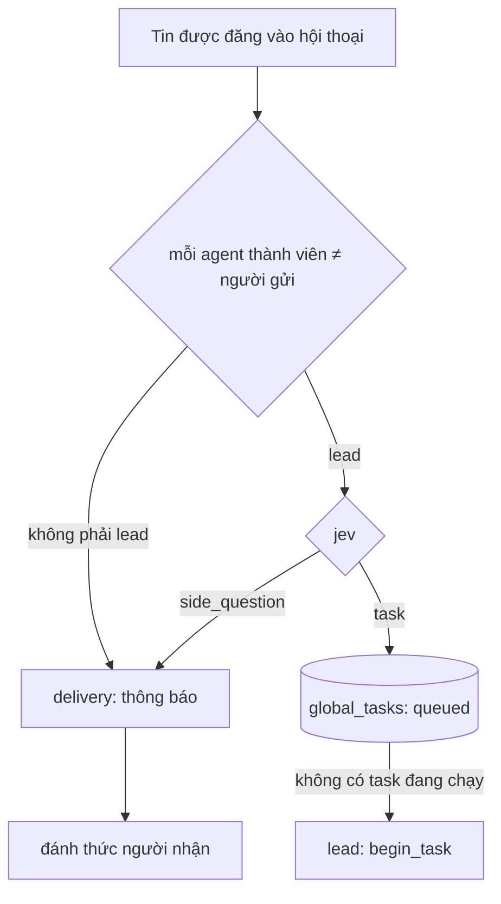
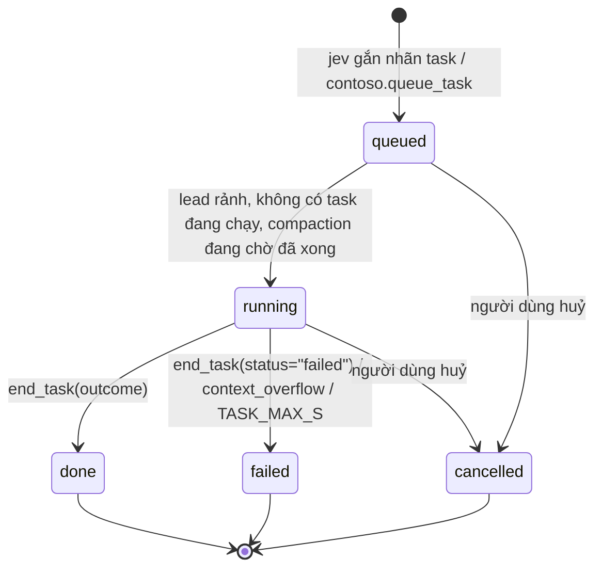

# 07 · Trigger, định tuyến và hàng đợi task toàn cục

Mỗi input trải qua những gì trước khi tới agent. **Phụ thuộc:** [01](01-glossary.md), [06](06-context-and-compaction.md), [08](08-communication.md).

## Trigger

| Trigger | Người nhận | Phân loại bởi | Kết quả |
|---|---|---|---|
| Tin của người dùng trong một hội thoại | mọi agent thành viên của hội thoại | jev cho bản của lead; không phân loại với agent khác | lead: task toàn cục hoặc thông báo; agent khác: thông báo |
| Tin của agent (`send_to_agent`, hoặc `send_to_user` vào nhóm) | mọi agent thành viên khác của hội thoại | jev cho bản của lead | như trên |
| Người dùng mở app (`POST /api/presence`, tối đa 30 phút một lần cho mỗi người dùng) | lead | đã phân loại sẵn | notice `presence` |
| Thay đổi từ builder, khởi động lại, task bị huỷ hoặc hết giờ | agent liên quan | đã phân loại sẵn | notice |
| Lịch chạy tới hạn | chủ sở hữu | đã phân loại sẵn | lịch chạy chuyển sang chờ ([09](09-routines.md)) |
| Compaction chuyển sang chờ | chính nó | có sẵn | chạy ở điểm an toàn ([06](06-context-and-compaction.md#compaction)) |



## Delivery

- Đăng một tin ghi một dòng `deliveries` cho mỗi agent nhận, trong cùng transaction với dòng `messages`. Người gửi không bao giờ nhận lại tin của chính mình.
- `route = 'jev'` cho bản của lead và `'notification'` cho những agent khác. Notice là một delivery có `notice` jsonb thay cho `message_id`.
- Thông báo được nối vào cuối context của người nhận ở activation kế tiếp ([03](03-agent-loop.md#activation)). Người nhận tự quyết khi nào xử lý: ngay nếu đang rảnh, nếu không thì sau khối công việc hiện tại. **Harness không bao giờ ngắt một vòng lặp đang chạy.**
- **Tham gia.** Một tin được đăng trong lúc người dùng có task đang chạy sẽ ghi `task_involvement(task, agent)` cho người gửi (nếu là agent) và cho mọi agent nhận.

## jev

jev phân loại mọi delivery tới lead có `route='jev'`. Cả `POST` của người dùng lẫn lời gọi helper của người gửi đều không chờ nó:

- Delivery được ghi với `status='classifying'`, và runner của lead bỏ qua delivery ở trạng thái đó.
- jev chạy trong một task asyncio nền, khởi động sau khi transaction của tin nhắn commit.
- Một `asyncio.Lock` riêng cho mỗi lead khiến các lần gọi jev của một lead chạy lần lượt, theo thứ tự delivery, nên task được xếp hàng theo thứ tự tin nhắn đến.
- Khi khởi động, delivery còn ở `classifying` được phân loại lại.

### Context

```text
build_jev_ctx(lead, msg) =
    lead.current_state            # render ngay lúc này, gồm task đang chạy và độ dài hàng đợi
  + lead.summary                  # tóm tắt của epoch hiện tại
  + K message event cuối của lead # tin lead đã gửi hoặc nhận, mới nhất ở cuối; không gồm output của tool
  + msg                           # người gửi, hội thoại, nội dung, tên tệp đính kèm
```

- `K = JEV_K` (mặc định 20). Các message event lấy từ `messages` nối với tư cách thành viên hội thoại của lead, không lấy từ `events` thô của lead.
- **Cách render** (`harness/jev.py`): khối `current_state`, rồi `<summary>` nếu không rỗng, rồi `<recent_messages>` với mỗi message một `<m id from thread at>`, rồi message mới dạng `<message id from thread at>` kèm dòng `attachments:`. jev decision lưu `{"state": ..., "questions": ...}` làm `input`.
- Phần còn lại của hệ thống chỉ phụ thuộc vào nhãn đầu ra của jev, nên chính sách này đổi được mà không đụng tới phần khác ([quyết định 0002](decisions/0002-jev-reads-the-receivers-view.md)).

### Phân loại

jev là một model quyết định "System One" không sinh văn bản (Jev của TypeSafe AI), gọi qua Decisions API của OpenRouter (`POST /api/alpha/decisions`, `ModelClient.decide`) với cùng `OPENROUTER_API_KEY` như mọi lời gọi model khác ([quyết định 0008](decisions/0008-platform-openrouter-key-no-byok.md)). Nó không bao giờ sinh văn bản: request là một câu hỏi `choice` duy nhất (`route`) với `criteria` lấy từ `platform/jev_criteria.yaml` (người vận hành sửa được, đọc lại mỗi lần gọi):

```yaml
task: "New, independent work that deserves its own place in the queue: a new analysis, report, comparison or piece of work that doesn't depend on the running task."
side_question: "Help, data or results for the current task; status questions; answers to a question the lead asked; thanks, greetings, small talk; corrections or additions to the running task."
```

Câu trả lời là `{choice, probabilities, confidence}` — một câu trả lời có kiểu, không phải văn xuôi. **Model.** `JEV_MODEL` (mặc định `typesafe/jev-1.14`). Không có tham số sampling: Decisions API quyết định, không sinh văn bản theo mẫu, nên không có gì để chỉnh.

**Ngưỡng độ tin cậy.** `confidence` (0–1) của jev được so với `JEV_CONFIDENCE_FLOOR` (mặc định `0.6`): dưới ngưỡng, `label` lưu lại bị ép về `side_question` bất kể jev ưu tiên lựa chọn nào. Điều này giữ nguyên tính an toàn đã ghi nhận — một yêu cầu lead không chắc chắn phân loại sẽ rơi về thông báo thay vì âm thầm xếp hàng sau chính task nó có thể phụ thuộc — và thể hiện trong dữ liệu là một dòng `side_question` với `confidence` thấp ([quyết định 0023](decisions/0023-jev-classifies-via-openrouter-decisions-api.md)).

### Tác động

| Nhãn | Tác động |
|---|---|
| `task` | Ghi `global_tasks(status='queued', description=<văn bản tin nhắn, cắt còn 500 ký tự>, source_message_id)`, đặt delivery thành `consumed` (lead sẽ thấy nó sau, trong `<begin_task>`), đánh thức lead |
| `side_question` | Đặt delivery thành `pending`, để lead nhận nó dưới dạng thông báo; đánh thức lead |

**Lỗi.** Khi hết giờ (10 s), response không hợp lệ (thiếu `answers.route`, `choice` lạ), hoặc lỗi model sau các lần thử lại ở [03](03-agent-loop.md#gọi-model), nhãn là `side_question` với `fallback=true`. Không tin nào bị mất, vì lead đằng nào cũng thấy.

### Ghi nhận

Mỗi lần gọi ghi một dòng `jev_decisions`: `input` (`{state, questions}`), `label`, `confidence`, `model`, `latency_ms`, `fallback` và `trace_id`. jev không bao giờ tạo ra tiêu đề của task — đó luôn là văn bản của tin nhắn gốc, cắt còn 500 ký tự. Lần gọi jev cũng là một `generation` tên `jev` trong trace của bên đăng tin ([13](13-observability.md)). Trong chế độ xem trace, admin có thể đánh dấu một quyết định là gắn nhãn sai, việc đó đặt `observed`. So sánh `label` với `observed` đo được độ chính xác của jev.

## Hàng đợi task toàn cục

Mỗi người dùng có một hàng đợi FIFO trong `global_tasks`, chỉ lead của người đó điều khiển ([quyết định 0001](decisions/0001-one-global-queue-per-user-owned-by-the-lead.md)).



- **Tối đa một task đang chạy cho mỗi người dùng.** Một partial unique index cưỡng chế điều này: `UNIQUE (user_id) WHERE status='running'`.
- **Bắt đầu.** Khi runner của lead tới quy tắc 4 ([03](03-agent-loop.md#activation)), nó chuyển task `queued` cũ nhất sang `running` (đặt `started_at`), ghi `task_involvement(task, lead)`, và nối `<begin_task>` với mô tả và tin gốc.
- **Kết thúc.** `contoso.end_task(outcome, status="done")` chỉ dành cho lead, và chỉ cho task đang chạy. Nó đặt `ended_at`, `outcome` và `ended_by='lead'`, phát `task.updated`, và khiến điểm rảnh kế tiếp của lead trở thành điểm an toàn cho mọi agent đã tham gia.
- **Huỷ.** `POST /api/tasks/{id}/cancel` (do người dùng) đặt `cancelled` và `ended_by='user'`. Lead và mọi agent đã tham gia nhận notice `task_cancelled` để dừng.
- **Hết giờ.** Bộ lập lịch đặt `failed` với `ended_by='timeout'` khi `now - started_at > TASK_MAX_S` (mặc định 3600), và gửi cùng loại notice.
- **Lead sở hữu mọi task toàn cục.** Nó tự làm hoặc giao từng phần cho agent khác bằng `send_to_agent`.
- **`contoso.queue_task(description)`** (chỉ lead) xếp hàng một task trực tiếp, ví dụ khi lead thấy một câu hỏi phụ thực ra là việc mới.

### Yêu cầu từ agent khác

Agent không phải lead tạo task toàn cục bằng cách gửi tin cho lead. jev phân loại nó như tin của người dùng.

**Chống deadlock.** Yêu cầu gửi lead để xếp hàng chỉ được dành cho việc mới, độc lập. Sự giúp đỡ cần cho task *hiện tại* không được thành task xếp hàng, vì nó sẽ đứng chờ sau chính task cần nó. jev thấy task đang chạy trong `current_state` của lead, và tiêu chí `side_question` trong `platform/jev_criteria.yaml` bao quát các yêu cầu như vậy. Lead vẫn có thể sửa nhãn sai bằng cách gọi `end_task` cho task bị sai, hoặc tự xử lý mục đã xếp hàng.

### "Người dùng mở app"

Khi cửa sổ trình duyệt được focus, nó gọi `POST /api/presence`. Server chỉ gửi lead notice `presence` nếu lần gần nhất đã cách hơn 30 phút (nó xem delivery `presence` gần nhất của lead, nên việc giãn cách vẫn đúng sau khi khởi động lại). Chỉ lead nhận nó, và lead tự quyết có nói gì không, ví dụ một bản tóm tắt buổi sáng.
