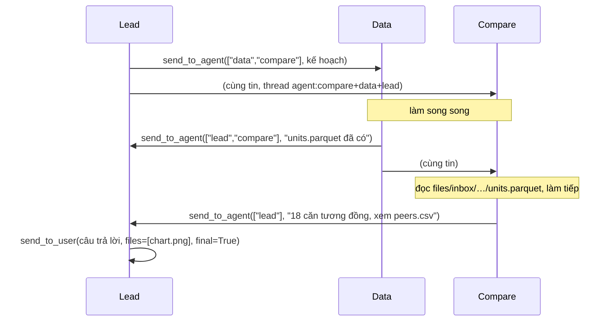

# 08 · Giao tiếp

Người dùng và agent nói chuyện với nhau thế nào. **Phụ thuộc:** [01](01-glossary.md), [07](07-routing-and-queue.md), [11](11-sandbox.md).

## Hội thoại

Mỗi tin nhắn thuộc về một hội thoại; hội thoại có loại và tập thành viên cố định.

| Loại | Thành viên | Được tạo | Người dùng thấy |
|---|---|---|---|
| `direct` | người dùng + 1 agent | cùng lúc với agent; đúng một cho mỗi agent | có |
| `group` | người dùng + ≥ 2 agent | bởi người dùng ("Nhóm mới") | có |
| `agent` | ≥ 2 agent, không có người dùng | ở lần `send_to_agent` đầu tiên giữa đúng tập thành viên đó | không (chỉ admin) |

- **Một quy tắc cho mọi loại: tin đăng vào hội thoại tới mọi thành viên trừ người gửi.** Agent nhận nó dưới dạng delivery ([07](07-routing-and-queue.md#delivery)); người dùng thấy nó trong UI nếu là thành viên.
- **Hội thoại `agent` được tìm bằng `member_key`**, các slug đã sắp xếp nối bằng `+` (vd `chart+data+lead`), duy nhất cho mỗi người dùng. Cuộc trò chuyện giữa cùng các agent luôn rơi vào cùng một hội thoại.
- **Thành viên nhóm.** Người dùng có thể đổi tên nhóm và thêm/bớt agent. Bỏ một agent không xoá các tin cũ của nó. Lead là tuỳ chọn trong nhóm; nếu là thành viên, bản của nó đi qua jev.
- **Agent bị xoá** bị bỏ khỏi các nhóm. Hội thoại trực tiếp của nó vẫn còn, ở chế độ chỉ đọc.

## `send_to_user`

```python
send_to_user(text: str | None = None, *, files: Sequence[str] = (), choices: Sequence[dict] | None = None,
             reports: Sequence[str] = (), thread: str | None = None, reply_to: str | None = None,
             final: bool = False) -> str  # message id
```

- **`thread`** mặc định là `CONTOSO_DEFAULT_THREAD`:
  - trong activation `message`, hội thoại của delivery mới nhất đã tiêu thụ đến từ người dùng;
  - trong activation `task`, hội thoại của tin gốc của task;
  - còn lại (lịch chạy, hay input chỉ đến từ agent), hội thoại trực tiếp của agent.
- **Kiểm tra hội thoại.** Hội thoại phải có người dùng và agent gửi; hội thoại `agent`, và hội thoại agent không ở trong (hội thoại trực tiếp của agent khác), gây `ValueError` (400 `invalid_thread`). Hội thoại chỉ đọc là 409 `thread_read_only`. Trong nhóm, tin cũng tới các agent thành viên khác, theo quy tắc chung ở trên.
- **`files`** là đường dẫn tương đối trong thư mục. Mỗi file phải tồn tại và không quá 20 MB, tối đa 10 file. `api` sao chép chúng sang `/data/attachments/<message_id>/<name>` và ghi `sha256`, nên sửa file trong thư mục sau đó không làm đổi thứ đã gửi.
- **`choices`** là `[{"id": "pdf", "label": "PDF"}, …]`, tối đa 6. UI hiện chúng thành chip. Một cú bấm đăng một tin bình thường của người dùng với `content.choice_id` và `content.reply_to`, và text của nó là nhãn của lựa chọn.
- **`reports`** là id phiên bản báo cáo (`"R7-v1"`) thuộc về người dùng, tối đa 5. Chúng trở thành `content.report_refs`, được UI hiện thành thẻ tham chiếu báo cáo mở phiên bản đã lưu ([19](19-reports-dashboard-notifications.md#trong-chat)). Phiên bản không tồn tại gây `ValueError`.
- **`final=True`** kết thúc activation sau exec này, nếu exec thoát với mã 0 ([03](03-agent-loop.md#nói-với-người-dùng)).
- **Trong lúc compaction** nó gây `RuntimeError("messaging is disabled during compaction")`.

## `send_to_agent`

```python
send_to_agent(receivers: Sequence[str], content: str, *, files: Sequence[str] = (),
              thread: str | None = None, reply_to: str | None = None) -> str  # message id
```

- **`receivers`** là các slug trong nhóm của cùng người dùng. Slug không tồn tại hoặc đã xoá gây `ValueError`. Người gửi không được là người nhận.
- **Không có `thread`,** tin vào hội thoại `agent` có thành viên là `{người gửi} ∪ receivers`, được tạo ở lần dùng đầu.
- **Có `thread`,** đó phải là hội thoại `group` chứa người gửi và mọi người nhận; khi đó người dùng thấy tin. `receivers` phải trùng với các agent thành viên khác của hội thoại, vì mọi thành viên đều nhận mọi tin.
- **`files`** được sao chép giống tệp của người dùng, nên người nhận đọc chúng ở `files/inbox/m_<message_id>/` trong thư mục của chính mình. Agent không bao giờ đọc trực tiếp thư mục của nhau.
- **Định tuyến.** Bản của lead đi qua jev; mọi người nhận khác nhận thông báo.

## Các helper khác

| Helper | Ai dùng | Tác động |
|---|---|---|
| `end_task(outcome: str, status: str = "done")` | lead | kết thúc task đang chạy ([07](07-routing-and-queue.md#hàng-đợi-task-toàn-cục)) |
| `queue_task(description: str)` | lead | xếp hàng một task trực tiếp |
| `write_summary(text: str)` | mọi agent, chỉ trong lúc compaction | đặt tóm tắt cho epoch kế tiếp |

## Tệp của người dùng

- **Tải lên.** Người dùng tải file lên bằng `POST /api/threads/{id}/messages` (multipart), mỗi file tối đa 20 MB. File được lưu một lần ở `/data/attachments/<message_id>/`.
- **Sao chép vào thư mục.** Với mỗi agent nhận, `api` sao chép file sang `files/inbox/m_<message_id>/<name>` trong thư mục của agent đó, trước khi ghi delivery. Nó commit với tác giả `contoso-harness` khi job lock của agent nhận đang rảnh. Nếu agent nhận đang chạy một exec, bản sao để snapshot của exec đó commit: chờ lock ngay trong lời gọi gửi tin có thể làm hai agent đang nhắn cho nhau giữa exec bị deadlock. Tên trùng được thêm hậu tố ` (2)`, ` (3)`…
- **Thông báo.** Thông báo liệt kê các đường dẫn đó ([06](06-context-and-compaction.md#các-mục-input)).

## Cùng làm một task

Trong một task toàn cục, lead điều phối và các agent khác làm song song. Mọi tin đều là thông báo, nên không agent nào bị ngắt giữa khối công việc. Agent có thể nhận tin mà quyết định không làm gì; nó chỉ đơn giản là tiếp tục rảnh.



## Ai thấy gì

| Người xem | Trực tiếp | Nhóm | Hội thoại agent | Suy luận và output tool |
|---|---|---|---|---|
| Người dùng | của mình | của mình | — | — |
| Admin | tất cả | tất cả | tất cả | tất cả (chế độ xem trace, [13](13-observability.md)) |
| Người dùng khác | — | — | — | — |
