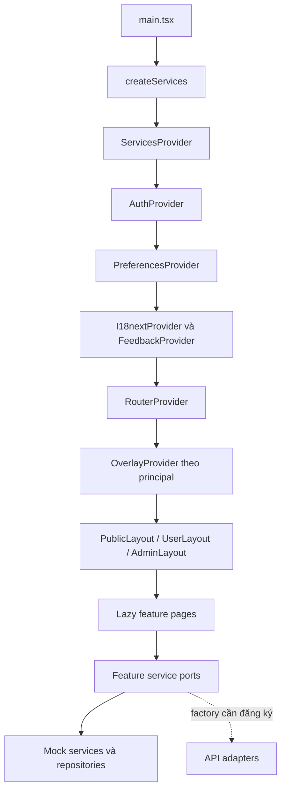

# 14a · Kiến trúc frontend

**Phụ thuộc:** [14](14-frontend.md), [14c](14c-frontend-adapters.md), [quyết định 0022](decisions/0022-ui-from-refactor-ux-from-spec.md)

Frontend dùng React 19, TypeScript và Vite, với React Router cho route và i18next cho giao diện tiếng Việt/Anh. Phiên bản dependency chính xác được khóa trong [`package.json`](../../frontend/package.json) và `frontend/package-lock.json`.

## Stack giao diện

**Trạng thái:** Đã có (mock)

Stack UI ràng buộc là stack của repo này: React 19, CSS thuần với token (`frontend/src/shared/styles/tokens.css`), primitive Radix, i18next, chuyển động GSAP và SVG chart renderer riêng (`shared/charts`). Xem [quyết định 0022](decisions/0022-ui-from-refactor-ux-from-spec.md). Không dùng stack Tailwind/shadcn/TanStack Query/Shiki/react-virtual của spec.

Không có thư viện cache truy vấn. Quy tắc realtime của spec "khi SSE kết nối lại thì làm mới toàn bộ" được đáp ứng bằng cách đọc lại các service port sau khi kết nối lại: mỗi page đang mount gửi lại các lần đọc qua port của feature. **Trạng thái:** Dự kiến (chưa có SSE transport; xem [14](14-frontend.md#hiện-trạng-so-với-mục-tiêu)).

## Bản đồ source

| Thư mục | Trách nhiệm |
| --- | --- |
| [`src/app`](../../frontend/src/app) | Bootstrap services, router, layout, shell, provider và tích hợp workspace. |
| [`src/features`](../../frontend/src/features) | Auth, dashboard, reports, chat, notifications, settings, admin-users; mỗi feature giữ page, model và service port của mình. |
| [`src/mocks`](../../frontend/src/mocks) | Fixture, repository, scenario và implementation mô phỏng của các port. |
| [`src/shared/contracts`](../../frontend/src/shared/contracts) | Auth, preferences, service result, feature registration và notification target dùng chung. |
| [`src/shared/ui`](../../frontend/src/shared/ui) | Button, form, identity, feedback, page, bảng, pagination và overlay. |
| [`src/shared/charts`](../../frontend/src/shared/charts) | Chart contract, kiểm tra tương thích, SVG renderer, bảng dữ liệu và mở rộng biểu đồ. |
| [`src/shared/motion`](../../frontend/src/shared/motion) | Vòng đời chuyển động phân tích bằng GSAP. |
| [`src/shared/styles`](../../frontend/src/shared/styles) | Token và CSS nền của ứng dụng. |
| [`tests`](../../frontend/tests) | Test tích hợp, domain dùng chung và Playwright journey. |

## Khởi động và composition

[`main.tsx`](../../frontend/src/main.tsx) đọc `VITE_SERVICE_MODE`, tạo `Services` rồi render `App` trong `StrictMode`. Lỗi cấu hình service có màn hình khởi động riêng. Xem [14c](14c-frontend-adapters.md) để biết cách đăng ký implementation.

`ErrorBoundary` bao quanh cây ứng dụng. `App` tạo browser router theo vòng đời mount và dispose khi cleanup. `UserLayout` còn cung cấp trạng thái thông báo người dùng qua `NotificationsProvider`.

[`feature-registry.ts`](../../frontend/src/app/feature-registry.ts) kết hợp các feature core (chat, notifications, settings) với dashboard, reports và admin-users từ [`integrations/workspace.ts`](../../frontend/src/app/integrations/workspace.ts). Mỗi `FeatureRegistration` khai báo route, role, layout, frame, lazy loader và thứ tự navigation. `validateRegistrations` kiểm tra route và vai trò hợp lệ. Auth đăng ký loader cho `/login` riêng.

Router kiểm tra session trước khi mount page. Hiện `USER` vào `/`, `ADMIN` vào `/admin/users`; trang đích mục tiêu khác (xem [14b](14b-frontend-pages.md#route-và-quyền-truy-cập)). Route guard phục vụ giao diện; adapter/backend vẫn phải kiểm tra quyền truy cập dữ liệu.

## Ranh giới dữ liệu

Page lấy dependency qua `useServices` hoặc `useWorkspaceService`. Các service interface thuộc `features/*/services`; [`Services`](../../frontend/src/app/services/services.ts) là hợp đồng dependency của ứng dụng, độc lập với kiểu trả về của mock factory.

Repository trong feature là ranh giới dữ liệu nội bộ. Ví dụ `ReportsService` nhận principal của ứng dụng; mock integration ánh xạ principal đó sang phạm vi quyền mà `ReportsRepository` sử dụng. Hai kiểu `Principal` trong shared auth và report model phục vụ hai lớp khác nhau.

Nội dung báo cáo được chiếu từ đúng `detail.version`. `deriveReportVersionSummary` giữ identity của bản lưu; `deriveReportDashboardView` chọn bố cục tổng quan báo cáo gọn; `ReportDocument` đọc tài liệu đầy đủ. Không lấy giá trị dashboard nghiệp vụ để điền vào một snapshot báo cáo. Chi tiết tại [14e](14e-report-viewer.md).

Một ngoại lệ có chủ đích: desktop trước đăng nhập đọc projection công khai từ fixture Riverside qua `auth/desktop/preview-model.ts`, không gọi service báo cáo được bảo vệ. Nội dung chat Riverside cũng được tạo tại lớp mock từ nguồn báo cáo chuẩn, rồi đưa vào UI qua `ChatService`.

## State và vòng đời

| State | Nơi sở hữu | Identity hoặc vòng đời |
| --- | --- | --- |
| Session | AuthProvider / AuthService | Principal và thời điểm hết hạn. |
| Tùy chọn và bản xem trước | PreferencesProvider | Tách theo principal; scope `public` trước đăng nhập. |
| Bộ lọc dashboard, reports, admin | URL | Phạm vi nghiệp vụ, sort, pagination, đối tượng đang mở. |
| Báo cáo đang xem | URL và service read | `report`, `version`, `view`; identity request có principal. |
| Scroll, biểu đồ đang mở rộng | Ref/state trong viewer | Tồn tại khi viewer còn mount; expansion reset khi đổi identity/mode. |
| Hội thoại, tin nhắn và draft | ChatService / ChatPage | Conversation ID, message ID, request ID và sequence. |
| Trạng thái đã đọc | NotificationsProvider / service | Optimistic update có xử lý thất bại; tách theo principal. |
| Đổi trạng thái tài khoản | Status controller / AdminUsersService | Revision và operation ID; yêu cầu xác nhận trước mutation. |
| Cửa sổ desktop | Reducer trong PreAuthDesktop | Vị trí, thứ tự và trạng thái cửa sổ trong lần mount. |

[`useServiceRead`](../../frontend/src/features/reports/hooks/useServiceRead.ts) hủy request cũ và không công bố kết quả lỗi thời. Khi đổi phiên bản, viewer hiển thị loading trong lúc đọc bản mới. Khóa đọc danh sách báo cáo loại bỏ `report`, `version`, `view`, nên chuyển nội dung viewer không làm đọc lại danh sách chỉ vì ba tham số này.

Không có thư viện cache truy vấn riêng trong dependency hiện tại. Khi thêm cache, identity phải bao gồm principal và toàn bộ scope/version liên quan.

## Lưu trữ mock

**Trạng thái:** Đã có (mock)

| Dữ liệu | Cơ chế hiện tại |
| --- | --- |
| Session demo | `sessionStorage`, qua storage adapter, scope `public`. |
| Preferences | `localStorage`, tách theo principal hoặc `public`. |
| Read map của thông báo người dùng | `localStorage`, tách theo principal. |
| Inspector chat mở/đóng | `sessionStorage`, tách theo principal. |
| Chat bundle, lịch sử và draft | IndexedDB `vdaagent-demo`, version 2, object store `scopes`, key là principal ID. |
| Report/dashboard fixtures và thay đổi admin demo | Repository/bộ nhớ của mock runtime. |

Storage adapter dùng tiền tố `vdaagent:v1:`. Khi browser storage không dùng được, các adapter có cơ chế bộ nhớ và cờ degraded. Chat repository kiểm tra dữ liệu đọc vào, hỗ trợ migrate bundle v1 sang v2; draft attachment sau khi đọc lại yêu cầu đính kèm lại. Các tin còn pending/responding khi được đọc lại chuyển sang interrupted.

Reset dữ liệu trong Settings chỉ đặt lại chat và trạng thái đọc thông báo người dùng của tài khoản hiện tại; giữ preferences. Nó không phải thao tác reset toàn bộ dataset hay database backend.

## Giao diện và chuyển động

`tokens.css` định nghĩa màu, typography, spacing, radius, elevation và motion; `globals.css` áp dụng theme, density, focus và các quy tắc nền. Font Be Vietnam Pro được đóng gói qua `@fontsource`; icon dùng Lucide và asset nhận diện trong `public/icon`.

Shell dùng navigation theo role, rail trên desktop và drawer trên màn hình hẹp. Chat có khu chọn agent, timeline và inspector; dưới các breakpoint trong CSS, các vùng phụ chuyển thành drawer (mục tiêu: mỗi lần một pane, xem [14](14-frontend.md#hiện-trạng-so-với-mục-tiêu)). Report viewer dùng một Radix dialog cho cả tổng quan báo cáo và tài liệu; chart expansion nằm trong dialog đó.

PreferencesProvider quản lý theme, locale, timezone, density và reduced motion. Nội dung báo cáo/hội thoại đã biên soạn giữ ngôn ngữ nguồn; đổi locale thay nhãn điều khiển và định dạng hiển thị.

[`useAnalyticalMotion`](../../frontend/src/shared/motion/useAnalyticalMotion.ts) quản lý GSAP context và cleanup. Reveal không thay số liệu, tọa độ hay khoảng trống dữ liệu. Tùy chọn giảm chuyển động của hệ điều hành hoặc ứng dụng bỏ qua hiệu ứng. Desktop trước đăng nhập có motion hook riêng trong `auth/desktop`.

Hướng dẫn kiểm tra theo lớp nằm trong [14g](14g-frontend-development.md).
