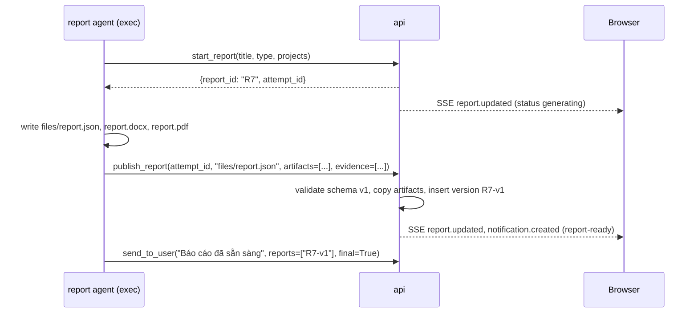

# 19 · Kho báo cáo, dashboard nghiệp vụ, thông báo người dùng và tuỳ chọn cá nhân

Frontend đã có sẵn bốn tính năng workspace mà spec PoC ban đầu không đề cập: kho báo cáo (`/reports`), dashboard nghiệp vụ (`/`), hộp thư thông báo người dùng (user notification) (`/notifications`) và cài đặt cá nhân (`/setting`). Tài liệu này cho mỗi tính năng một backend theo các quy tắc của PoC. **Phụ thuộc:** [08](08-communication.md), [10](10-data-model.md), [11](11-sandbox.md), [12](12-auth-and-domains.md), [14](14-frontend.md), [15](15-api.md#mở-rộng-workspace).

**Trạng thái:** backend Đã có (API): `backend/reports/`, `backend/api/{reports,dashboard,inbox}.py`, các route nội bộ cho báo cáo/dataset. Frontend của cả bốn là Đã có (mock) ([14b](14b-frontend-pages.md)); adapter API là S12a.

**Ghi chú triển khai.** Artifact lưu dưới `/data/reports/<uuid phiên bản>/` (mã phiên bản lặp lại giữa các người dùng). `mediaType` của artifact là loại thật, gồm cả PDF, DOCX và XLSX; union `Artifact.mediaType` của frontend (HTML, CSV) cần mở rộng ở S12a. `policyVersion` là `report-policy-v1` và `contentRevision` là 16 ký tự hex đầu của sha256 của schema đã lưu. `publish_report` không có `source` sẽ ghi `{id: "agent:<slug>", completeness: "partial"}`. Kết thúc một lần tạo đã kết thúc là 409 `attempt_ended`.

**Một mốc thời gian cho mỗi phiên bản.** `publish` đặt `report_versions.completed_at` từ Python (`datetime.now(UTC)`) thay vì dùng mặc định `now()` của cột — trong Postgres `now()` là thời điểm **bắt đầu transaction** — và lấy chính mốc đó làm `source.dataThrough` mặc định. Trước khi sửa, khi không truyền `source`, `dataThrough` rơi vào vài mili-giây **sau** `completed_at`, nên API trả cho giao diện một source mới hơn chính phiên bản đó; `decodeReportVersion` từ chối ("Report source is newer than saved version") và vì danh sách báo cáo giải mã toàn bộ dòng trong một lượt, cả Kho báo cáo hiện "Chưa đọc được báo cáo". Test `backend/tests/harness/test_reports_internal.py::test_publish_without_a_source_keeps_the_version_readable` giữ lỗi này. Phía đọc, một phiên bản bị từ chối vì lý do khác ngoài sai identity chỉ chuyển thành `schemaIssue` ở đúng dòng đó (`frontend/src/adapters/api/reports.ts`), nên một phiên bản cũ không thể làm trắng cả thư viện. Các dòng phát hành trước khi sửa giữ nguyên `completed_at` gốc: `report_versions` là bất biến nên không sửa tại chỗ được.

**Trường tùy chọn vắng mặt thì bỏ hẳn, không ghi `null`.** JSON không có `undefined`, còn helper `optional()` phía frontend từ chối `null` tường minh, nên trường tùy chọn vắng mặt phải được bỏ khỏi schema đã lưu. `backend/reports/schema.py` vì vậy bỏ `type`, `description`, `dimension.unit` và `semantic` của chart khi agent không gửi (block `description`/`span` và metric `definition`/`comparison` vốn đã được bỏ sẵn). Ghi `"unit": null` làm `decodeReportSchema` lỗi, giao diện hiện "Phiên bản schema chưa được hỗ trợ" — một báo cáo có đủ 5 block `chart` hợp lệ vẫn hiển thị **không có biểu đồ nào**. `backend/tests/reports/test_schema.py::test_an_absent_optional_is_omitted_never_stored_as_null` giữ phía ghi, và `frontend/src/features/reports/tests/schema.test.ts` phủ trường hợp chart đã lưu với `null`, vì phiên bản đã phát hành là bất biến và phải luôn đọc được.

## Nguyên tắc

1. **Agent publish; `api` không bao giờ đọc warehouse.** Credentials của miền nằm trong thư mục agent ([12](12-auth-and-domains.md#luồng-credentials)). Báo cáo và dữ liệu dashboard chỉ tới `api` qua các helper `contoso` mà agent gọi từ code của chính nó ([quyết định 0020](decisions/0020-agents-publish-reports-and-dashboard-data.md)).
2. **Mọi thứ thuộc về một người dùng.** Mỗi dòng có `user_id`, mỗi truy vấn lọc theo nó, và tài nguyên của người dùng khác trả 404 `not_found` ([12](12-auth-and-domains.md#vai-trò-và-phân-quyền)). Admin không có đội agent, nên không có báo cáo, dashboard hay nội dung hộp thư của riêng mình.
3. **Contract của frontend là hình dạng dữ liệu trên dây.** Body response dùng hình dạng của các kiểu domain frontend hiện có (`frontend/src/features/*/model/types.ts`, `frontend/src/shared/contracts/*`), ở dạng camelCase, để adapter API mỏng ([14c](14c-frontend-adapters.md)). API của spec lõi giữ hình dạng snake_case.
4. **Đã lưu nghĩa là bất biến.** Một phiên bản báo cáo đã publish, các artifact và bằng chứng của nó không bao giờ đổi. Phiên bản mới là một dòng mới.

## Kho báo cáo

### Vòng đời

| Helper | Endpoint internal | Tác dụng |
|---|---|---|
| `start_report(title, type, *, projects=(), markets=(), report_id=None)` | `POST /internal/v1/reports/start` | Tạo bản ghi báo cáo (trừ khi `report_id` chỉ tới một báo cáo có sẵn của người dùng này) và một attempt `running`. Trả `{report_id, attempt_id}`. |
| `publish_report(attempt_id, schema_path, *, artifacts=(), evidence=(), source=None)` | `POST /internal/v1/reports/publish` | Kiểm tra và lưu một phiên bản báo cáo mới; attempt thành `succeeded`. Trả id phiên bản. |
| `fail_report(attempt_id, reason)` | `POST /internal/v1/reports/fail` | Attempt thành `failed` với `reason`. |

- **Id.** Id báo cáo là `R<n>`, đánh số theo từng người dùng. Id phiên bản là `<report_id>-v<sequence>`, khớp với định danh frontend đang dùng (`R010-v2`).
- **Schema.** `schema_path` là một file JSON tương đối với thư mục agent, theo [schema báo cáo v1](14f-report-schema.md). Agent bỏ trống `reportId` và `versionId`; `api` điền vào trước khi kiểm tra.
- **Kiểm tra** áp dụng các quy tắc của decoder frontend `decodeReportSchema` ([14f](14f-report-schema.md#decoder-và-fallback)): `schemaVersion` 1, định danh khớp, id bằng chứng thuộc phiên bản này, không trùng id metric hay block, dòng bảng đầy đủ, `span` hợp lệ, độ sâu section ≤ 8, ngày phạm vi `[from, to)` với múi giờ IANA, số hữu hạn hoặc `null`. Khi lỗi, trả 400 `invalid_report` với vấn đề đầu tiên trong `message`; attempt vẫn `running`, nên agent có thể sửa file và publish lại. Decoder frontend vẫn chạy ở mọi lượt đọc; nó là tuyến phòng thủ cuối cùng.
- **Artifact.** Tối đa 10 file, mỗi file tối đa 20 MB, với media type HTML, CSV, DOCX, PDF hoặc XLSX. `api` chép chúng tới `/data/reports/<version_id>/<filename>` và ghi `sha256`, như với tệp đính kèm ([08](08-communication.md#send_to_user)). Phiên bản không có artifact vẫn hợp lệ; khi đó viewer không hiện nút tải.
- **Bằng chứng** là danh sách `{id, label, sourceId, projectIds, snapshotId, dataThrough, limitation}`; `source` là `{id, label, dataThrough, completeness}`. `dataThrough` không được muộn hơn thời điểm publish.
- **Attempt kết thúc cùng công việc của nó.** Khi một task toàn cục kết thúc (bất kỳ trạng thái nào), mọi attempt do nó bắt đầu mà vẫn `running` thành `failed` với lý do `task_ended`. Attempt bắt đầu ngoài task (ví dụ bởi một lịch chạy) bị fail sau `TASK_MAX_S`. Scheduler thực thi cả hai ([07](07-routing-and-queue.md)).
- **Trạng thái** được suy ra đúng như [`lifecycle.ts`](../../frontend/src/features/reports/model/lifecycle.ts) của frontend: báo cáo có phiên bản đã lưu là `completed` kể cả khi attempt mới hơn bị lỗi. Không có phiên bản đã lưu thì attempt `queued` hoặc `running` làm nó `generating`, attempt `failed` làm nó `failed`, attempt `succeeded` không có output làm nó `unsupported`, và không có attempt nào thì là `draft`.

### Đọc dữ liệu

Port `ReportsService` của frontend ánh xạ một-một lên các endpoint trong [15](15-api.md#báo-cáo). Tìm kiếm, bộ lọc, sắp xếp và phân trang dùng quy tắc của mock hiện tại, viết lại bằng Python (`backend/reports/read.py`, bản sao của `selectReports`/`summarizeRecord`/`paginate` chạy trên báo cáo của chính người dùng, để hai phía không lệch nhau) ([14e](14e-report-viewer.md), [14b](14b-frontend-pages.md)): tìm không phân biệt hoa thường và dấu trên mã, tiêu đề, dự án và tác giả (Unicode NFD bỏ dấu, `đ`→`d`, chữ thường, giống `fold` của frontend), tối đa 500 ký tự; key lặp lại nghĩa là "bất kỳ giá trị nào"; trang 25, 50 hoặc 100. Catalog (`GET /api/reports/catalog`) trả các dự án của người dùng (từ dataset dashboard mới nhất cộng các dự án được báo cáo nhắc tới), người dùng là tác giả duy nhất, slug các agent của người dùng, các loại báo cáo thấy trong báo cáo của người dùng, và phạm vi mặc định (30 ngày gần nhất theo múi giờ nghiệp vụ của dataset, hoặc `Asia/Ho_Chi_Minh`).

### Trong chat

`send_to_user(..., reports=["R7-v1"])` thêm `report_refs` vào tin nhắn ([08](08-communication.md#send_to_user)). Chat render mỗi tham chiếu thành một thẻ tham chiếu báo cáo, mở `/reports?report=R7&version=R7-v1&view=dashboard` ([14](14-frontend.md#khung-giữa-cuộc-trò-chuyện)). Phiên bản không tồn tại hoặc thuộc người dùng khác trả 400 `invalid_request`.

## Dashboard nghiệp vụ

### Dataset

Dashboard nghiệp vụ tại `/` được tính từ một **dataset** cho mỗi người dùng. Dataset đi qua ba nơi:

1. **Thư mục agent.** Một agent có credentials `warehouse` (thường là `data`) truy vấn kho dữ liệu bằng code của chính nó và ghi một file JSON trong thư mục của nó, ví dụ `files/dashboard.json`.
2. **Postgres.** `publish_dataset("dashboard", "files/dashboard.json")` khiến `api` đọc file đó từ volume `folders` dùng chung, kiểm tra và lưu một bản sao thành một dòng của `datasets` (`payload jsonb`, [10](10-data-model.md#datasets)). Sau đó, sửa file không ảnh hưởng tới dashboard cho tới khi được publish lại.
3. **Trình duyệt.** `GET /api/dashboard/dataset` trả dòng mới nhất, và trình duyệt tính dashboard từ đó ([Cách tính](#cách-tính)).

Chưa phần nào được xây dựng. Hiện tại dashboard mock đọc fixture sinh sẵn từ [`mocks/dashboard/fixtures.ts`](../../frontend/src/mocks/dashboard/fixtures.ts) (`createDashboardFixtures`).

| Helper | Endpoint internal | Tác dụng |
|---|---|---|
| `publish_dataset(kind, path)` | `POST /internal/v1/datasets/publish` | Lưu file JSON tại `path` làm dataset mới nhất loại `kind` của người dùng. Chỉ có `kind="dashboard"`. |

- **Hình dạng.** File là một `DashboardDataset` ([`dashboard/model/types.ts`](../../frontend/src/features/dashboard/model/types.ts)) không có `tasks` và `taskSource`: `businessTimezone`, `projects`, `snapshots` (snapshot tồn kho kèm các bất động sản), `transactions`, `transactionSource` và `coveredDates`. Ngày thiếu được bỏ khỏi `coveredDates`; vắng mặt nghĩa là không biết, không bao giờ là số không.
- **Kiểm tra.** Tối đa 20 MB; trường bắt buộc và kiểu; ngày ISO; `businessTimezone` theo IANA; mọi bất động sản và giao dịch chỉ tới một dự án đã biết. Khi lỗi, trả 400 `invalid_dataset`.
- **Lưu trữ.** `datasets` giữ năm dataset mới nhất cho mỗi người dùng và loại; lượt đọc dùng bản mới nhất.
- **Làm mới.** Không có gì tự làm mới dataset, và không agent mẫu nào kèm lịch chạy cho việc này. Người dùng nhờ một agent (thường là `data`, agent giữ credentials `warehouse`) dựng lại và publish, hoặc tự tạo lịch chạy cho việc đó trong tab **Lịch** của builder ([05](05-agent-builder.md#lịch-chạy)); agent cũng có thể tự tạo lịch chạy như vậy. Trước lần publish đầu tiên, dashboard hiện trạng thái rỗng ([Cách tính](#cách-tính)).

### Task trên dashboard

`GET /api/dashboard/dataset` thêm `tasks` và `taskSource` từ các attempt báo cáo của người dùng: mỗi attempt thành một `AnalysisTask` (`queued`/`running`/`succeeded`/`failed`, báo cáo và phiên bản của nó, và dự án đầu tiên của nó). Đó là thứ mà các KPI task của dashboard và quy tắc chú ý AT02 đếm.

### Cách tính

`api` không tính KPI. Adapter API của `DashboardService` tải dataset một lần mỗi khi đổi phạm vi và chạy các hàm thuần có sẵn trong [`features/dashboard/model`](../../frontend/src/features/dashboard/model) (dải tuổi tồn, tỷ trọng tồn kho chậm, xu hướng giao dịch, quy tắc chú ý AT01–AT03, trang phân rã), cùng số liệu tổng hợp báo cáo và báo cáo gần đây từ các endpoint báo cáo. Nhờ vậy các quy tắc và test của chúng ở một chỗ. Cái giá là cả dataset được gửi tới trình duyệt; xem [99](99-risks-and-future-work.md).

Khi người dùng chưa có dataset, endpoint trả `{"dataset": null}` và các phần tồn kho và giao dịch hiện trạng thái rỗng; các phần báo cáo và task vẫn hoạt động.

## Thông báo người dùng

Một **thông báo người dùng (user notification)** là một mục trong hộp thư tại `/notifications`. Nó không liên quan tới thông báo (notification) phía agent ([01](01-glossary.md)).

| Sự kiện | Loại | Đích | Nhóm tuỳ chọn |
|---|---|---|---|
| Một phiên bản báo cáo được publish | `report-ready` | phiên bản báo cáo | `reports` |
| Một attempt báo cáo lỗi, hoặc một task toàn cục kết thúc `failed` hay do hết giờ | `task-failed` | báo cáo, hoặc hội thoại trực tiếp với lead | `tasks` |
| Một agent gửi tin nhắn có `choices` | `action-required` | hội thoại | `tasks` |
| Admin tạo tài khoản | `account-created` | tài khoản (`/setting`) | luôn gửi |
| Admin đặt lại mật khẩu hoặc vô hiệu hoá tài khoản, hoặc miền của người dùng thành không khả dụng | `system` | chính thông báo đó | `system` |

- **Tuỳ chọn quyết định lúc tạo.** Nếu người dùng đã tắt một nhóm trong `/setting`, `api` không tạo thông báo người dùng thuộc nhóm đó. Bật lại không đem về các mục đã bỏ qua.
- **Nội dung** đến từ các mẫu cố định ở cả hai ngôn ngữ (`title` và `summary` dạng `{vi, en}`), nên hộp thư theo ngôn ngữ của người dùng mà không cần gọi server. Text của agent không bao giờ được chép vào thông báo người dùng.
- **`access`** được tính khi đọc hộp thư: `available` nếu đích tồn tại và thuộc người dùng, ngược lại là `missing`. (`restricted` vẫn nằm trong contract frontend cho tài nguyên chia sẻ sau này; `api` không phát ra nó.)
- **Trạng thái đã đọc.** `POST /api/notifications/read` đánh dấu các id được đưa, hoặc mọi mục chưa đọc khi không đưa id nào. Cập nhật lạc quan và rollback của frontend giữ nguyên ([14b](14b-frontend-pages.md)).
- **Realtime.** `notification.created` và `notification.read` được gửi trên luồng SSE của người dùng; số chưa đọc trong shell cập nhật từ chúng.
- **Lưu giữ.** `api` giữ 500 mục mới nhất cho mỗi người dùng và xoá các mục cũ hơn khi khởi động.
- **Không có ở đây:** thông báo đẩy, gửi qua email hay Zalo ([99](99-risks-and-future-work.md)).

## Tùy chọn cá nhân

- **Tên hiển thị** nằm trong `users.display_name` (tối đa 100 ký tự; lưu tuỳ chọn yêu cầu 1–100). `GET /api/auth/me` trả nó, và lưu tuỳ chọn sẽ cập nhật nó. Khi trống, UI hiện username.
- **Phần còn lại** (`locale` `vi`/`en`, `theme` `light`/`dark`/`system`, `timezone`, `motion`, `density`, nhóm thông báo) là một giá trị `jsonb` trong `user_preferences`, được kiểm tra theo quy tắc của [`isPreferences`](../../frontend/src/shared/contracts/preferences.ts) trong frontend. Body không hợp lệ trả 400 `invalid_request`.
- **Nút đổi theme.** Nút đổi nhanh trên header của app ([14](14-frontend.md#shell)) và trang cài đặt ghi cùng một tuỳ chọn `theme`.
- **Trước khi đăng nhập,** tuỳ chọn chỉ nằm trong trình duyệt, ở phạm vi `public` ([14a](14a-frontend-architecture.md#lưu-trữ-mock)).
- **Múi giờ chỉ để hiển thị.** Lịch chạy vẫn dùng `Asia/Ho_Chi_Minh`, và ngày nghiệp vụ của dashboard dùng `businessTimezone` của dataset.
- **Ngôn ngữ** thay đổi nhãn và định dạng số và ngày. Tin nhắn agent và báo cáo đã lưu giữ ngôn ngữ lúc được viết ([quyết định 0021](decisions/0021-bilingual-ui.md)).

## Desktop trước đăng nhập

Desktop tại `/login` giữ các cửa sổ xem trước. Nội dung của chúng là tài liệu tĩnh, công khai, đóng gói cùng frontend (hiện là bản chiếu fixture Riverside, [14b](14b-frontend-pages.md)); không có endpoint và không có dữ liệu được bảo vệ trước khi đăng nhập. Cửa sổ đăng nhập gửi tới `POST /api/auth/login` với username ([12](12-auth-and-domains.md#đăng-nhập-mức-poc)).

## Những gì chỉ có ở mock

- **"Reset demo data"** trong `/setting` chỉ reset các store mock phía trình duyệt. API không có thứ tương đương.
- **Mock scenario** (`?scenario=`) chỉ chọn hành vi mock ([14g](14g-frontend-development.md)).
